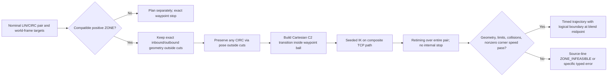

# Design: bounded ZONE flybys between LIN and CIRC commands

Date: 2026-11-13. Status: **design only; no source changes in this pass**. This extends the browser [first PTP ZONE contract](2026-11-13_zone_ptp_blend.md), while preserving [D-05's](2026-11-13_workcell_roadmap.md) exact stop by default. The [EASY-ROB ZONE investigation](../../notes/2026-11-12_easy_rob_orientation_zone.md) shows positive-zone flyby and millimetre API units, but does not identify its numeric blend law. The proposal below is specific to our metre-based browser language.

## Contract to accept for a first Cartesian release

`ZONE r` keeps its current range $0\le r\le0.2$ m. A boundary may blend only when **both** neighboring commands are `MOVEL` or `MOVEC`, both carry positive ZONE, and no intervening `ROBOT`, `TOOL`, `PAUSE` (including zero), `GRAB`, `RELEASE`, `WELD`, or scene event occurs. The smaller ZONE is used. A lone positive-zone command still stops exactly. For the first Cartesian release, exclude pairs executed while a weld seam is active, and require the TCP orientation to be constant across both entire commands (quaternion angular differences below $10^{-4}$ rad). This makes orientation continuous without inventing an SO(3) blend. Return a source-line `ZONE_ORIENTATION_UNSUPPORTED` for a compatible pair with changing orientation; do not quietly stop or claim to blend it. Future work can add a Lie-group orientation spline.

Let $P$ be the common nominal TCP waypoint in world coordinates. Only a local entry-to-exit interval may leave the original geometry. The inbound LIN/CIRC is **exact** from its start through the entry point; the outbound LIN/CIRC is **exact** from the exit point to its end. The transition remains in the ball $\|p-P\|\le r$. Since $P$ belongs to the original pair of curves, this also bounds the geometric distance to their union by $r$. This is a geometric envelope, **not** a circle with radius $r$, an acceleration setting, or an EASY-ROB equivalence claim. A positive pair that cannot satisfy the checks fails with `ZONE_INFEASIBLE` on the ZONE source line. `ZONE 0` leaves the waypoint and zero speed intact.

For CIRC, the programmed via pose is a hard waypoint. An inbound CIRC may be trimmed only *after* its via fraction; an outbound CIRC only *before* its via fraction. If there is insufficient room between via and the shared endpoint, shrink the transition or fail. The exact via fraction must remain a mandatory IK, timing, and playback sample. This protects long arcs as well as near-coincident via fractions already covered in `tests/planning.test.cjs`.

## Geometric construction

Use world-frame TCP positions $p\in\mathbb R^3$. For a LIN segment from $a$ to $b$, its unit tangent is $T=(b-a)/\|b-a\|$ and curvature vector $K=0$. For a CIRC segment with center $c$, radius $R$, signed sweep $\theta$, and plane normal $n$, the tangent at $p$ is $T=\operatorname{sgn}(\theta)\,n\times(p-c)/R$ and the curvature vector is $K=(c-p)/R^2$. Reject a zero-length LIN or near-degenerate CIRC at a candidate cut; the existing CIRC constructor already rejects duplicate/collinear defining points.

Choose entry and exit by walking distances $d_{\rm in},d_{\rm out}$ backward/forward along the exact original curves, initially within $r$ and then decreasing. Let the cut poses be $A,B$. A fifth-degree Cartesian Bézier curve $p_b(u)=\sum_{i=0}^{5}B_{i,5}(u)P_i$, $0\le u\le1$, can match position, tangent, and curvature at both cuts. With a positive geometric scale $h$ and derivatives $v_A=hT_A$, $v_B=hT_B$, $a_A=h^2K_A$, $a_B=h^2K_B$ in the common path parameter:

$$
\begin{aligned}
P_0&=A,&P_1&=A+v_A/5,&P_2&=A+2v_A/5+a_A/20,\\
P_5&=B,&P_4&=B-v_B/5,&P_3&=B-2v_B/5+a_B/20.
\end{aligned}
$$

This gives a C2 *geometric* splice when derivatives are expressed in the same parameter as the retained pieces. The scale $h$ is a search variable, not the ZONE radius. Reject candidate curves with loops or backward progress along either neighboring path. For a conservative continuous envelope check, require all six Bézier control points inside the radius-$r$ ball about $P$; the convex-hull property then keeps the entire transition inside that ball. This is sufficient rather than necessary, so a safe but poorly conditioned candidate may be rejected. A more permissive version could bound $\|p_b(u)-P\|$ by Bernstein subdivision.

For a two-command first release, the composite path is: exact inbound prefix, Bézier transition, exact outbound suffix. Parameterize the pieces by cumulative TCP arclength, expose `at(s)` and a list of **required fractions** (CIRC via points, entry, logical boundary, exit, final endpoint). Do not reuse the current joint-space `blendPTPCorner` for LIN/CIRC: its FK image is only checked approximately and does not construct a declared Cartesian curve.

## IK, timing, playback, and scene state

Resolve both commands' frame-relative targets first against the *nominal exact-stop* program state. This preserves existing `worldPose` meaning if a target uses a robot or model frame; the subsequent flyby is an explicit deviation from the nominal waypoint. Then solve the composite TCP path with seeded 6D IK from the current configuration. Extend `solveCartesianPath`'s single `viaFraction` support to an ordered `requiredFractions` list; otherwise a CIRC via may disappear when combined with another path. Retiming must cover the **whole compatible pair** with zero speed only at its outer endpoints. Retiming two separate `planMove` results and splicing afterward would retain their zero-velocity boundary and would be sensitive to the current joint interpolant. The `timeParameterize` path-residual check should compare every timed sample with this composite `at(s)` and retry denser IK sampling if needed.

The logical command boundary can be the transition's midpoint fraction, with `plans[i].endTime === plans[i+1].startTime` at its timed sample. The nominal waypoint is intentionally not visited. No grab, release, weld, pause, or tool change may occur at that boundary. Plan the pair and validate its collision scene **before** processing any later event: the current PTP implementation already had to move its blend check to this point to avoid using future attachment state. For three or more consecutive compatible Cartesian commands, either plan the maximal run as one composite path or return `ZONE_RUN_UNSUPPORTED` on the third command in the first implementation. Silently blending only one of two requested corners would be misleading.

The current `ProgramPlayer.qAt()` linearly interpolates joint positions between samples. It does not execute the planned spline exactly. To claim a TCP path tolerance during browser playback, either (a) serialize polynomial joint-segment coefficients and evaluate them in the player, or (b) adaptively densify output until an interval bound on FK error under linear interpolation is below a declared tolerance. Merely increasing a fixed sample count does not prove the bound. Existing ROS-shaped JSON is sampled output and should retain strictly increasing nanosecond stamps.

## Verification gate and feasibility limit

The current collision scene answers static `isStateValid(q)` and sampled/adaptive `isEdgeValid(a,b)`. `three-mesh-bvh` gives a narrow-phase static triangle query; it is **not continuous collision detection**. Therefore exact continuous collision safety for arbitrary STL geometry cannot honestly be claimed from current code. A first educational release can use the existing adaptive checks and say so. If the requirement is a continuous safety certificate, add a fail-closed interval verifier before enabling Cartesian ZONE:

1. Certify the Bézier waypoint envelope continuously by its control-point hull (above). Prove preserved LIN/CIRC prefixes and CIRC via by construction and mandatory samples.
2. Bound joint position/velocity/acceleration over each time-polynomial interval. For the current cubic joint interpolant composed with quintic time scaling, use Bernstein coefficient bounds with recursive subdivision or derivative-root isolation; a fixed grid alone is insufficient. Reject an unresolved interval with `ZONE_LIMIT_UNVERIFIED`.
3. For each robot/scene or robot/robot collision pair, bound how far each collision shape can move over a joint interval (revolute lever-arm and prismatic-displacement bounds). A static BVH closest-distance lower bound greater than the sum of motion bounds certifies that interval as clear. Subdivide ambiguous intervals; report `ZONE_COLLISION_UNVERIFIED` if the budget is exhausted. Attachments and mimic joints must be included in the motion bound. This is conservative and may reject safe mesh paths.
4. Bound FK residual to the commanded composite TCP curve between IK samples using interval Jacobian/Lipschitz bounds; otherwise report only a sampled path-tolerance guarantee. Preserve explicit position and orientation residual thresholds.

The interval gate is meaningful new work. It should be built as a reusable planner verifier, not a special claim attached only to ZONE. Until then, the product should state **sampled/adaptive checks** exactly as D-07 does. Infeasible and unverified are distinct outcomes.

## Minimal implementation map and acceptance tests

| File | Needed change |
|---|---|
| `frontend/planning/paths.js` | Expose LIN/CIRC tangent and curvature at fractions; add a composite Cartesian path and ordered required fractions, preserving CIRC via. |
| `frontend/planning/cartesian-zone.js` (new) | Search cut distances and Bézier scale, require orientation compatibility and ball/control-hull validity, reject loops, return typed geometry failures. |
| `frontend/planning/timing.js` | Time one composite path with required knots and no internal stops; return/verify logical boundary time and nonzero normalized speed. Add interval limit verifier if continuous bounds are required. |
| `frontend/program-plan.js` | Look ahead over compatible LIN/CIRC pairs, resolve nominal targets, plan and validate pair before future scene events, update plan times and source-line diagnostics. Protect weld-active pairs and longer runs. |
| `frontend/planning/collision-scene.js`, `ptp.js` | No change for sampled first release; add conservative swept-interval verification only for a continuous-certificate release. |
| `frontend/program-player.js` | Optional but required for exact playback tolerance: evaluate serialized joint polynomials or use certified adaptive samples. |
| `frontend/planning/worker-entry.js`, `snapshot.js` | Existing Worker snapshot can carry the same serializable results; no architectural change expected. |

Tests should include LIN→LIN right angle; LIN→CIRC, CIRC→LIN, CIRC→CIRC; a >180° CIRC sweep; exact via preservation near a blend; shrinking/rejection when via is too close; constant versus changing orientation; zero-ZONE and event barriers; a later GRAB that changes scene state; an obstacle intersecting only the blend; joint-limit and acceleration failure; a collision/interval-budget failure if certification is implemented; a three-command run; Worker/direct equivalence; strictly increasing ROS stamps; and Chromium top-view trace plus player seek at the logical boundary. Each positive case must compare FK against the declared composite TCP curve and quantify its maximum observed waypoint deviation, not merely assert that a plan exists.

**Recommendation:** implement the constant-orientation, two-command composite-path milestone first with sampled/adaptive safety language, then add the interval verifier and general SO(3) orientation blending as separate, reviewable milestones. The current modules support this without replacing the DSL or scene model, but they do not yet support continuous mesh-collision certification or exact spline playback.
