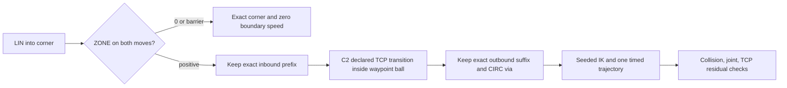

# Cartesian ZONE browser integration — 2026-11-13

The Program panel now reports Cartesian flyby corners separately from PTP flybys. Its help describes the first bounded LIN/CIRC ZONE release: fixed TCP orientation, one two-move pair, exact line/arc geometry outside a local transition, and exact CIRC via poses. The user can enter `ZONE 0` to stop at the shared waypoint or positive `ZONE r` (metres, up to 0.2) on both consecutive Cartesian commands to request a local flyby. The [core note](2026-11-13_cartesian_zone_core.md) describes construction and checked limits.

`tests/cartesian-zone-browser.test.cjs` loads the two-axis gantry and SDF plates in Chromium, plans the same LIN→LIN right angle with `ZONE 0` and `ZONE 0.07`, selects a top camera view, and seeks the actual `ProgramPlayer` to each logical boundary. With `ZONE 0`, the boundary joint state is (0.399991, 0) m within the configured IK tolerance of (0.4, 0), and velocity is exactly zero. With positive ZONE, the boundary joint state is (0.390155, 0.009842) m, with velocity approximately (0.0784, 0.0861) m/s. The maximum **sampled realized** TCP distance from the nominal waypoint is 0.052505 m, below the requested 0.07 m; the declared Bézier curve has a continuous waypoint-ball bound from its control hull. The positive-ZONE plan takes 6.395 s versus 2.647 s for the exact-stop plan because the first implementation retimes the entire pair conservatively. ROS-shaped trajectory stamps increase strictly in both runs. The browser reported no page errors.

Numeric [trace](artifacts/cartesian_zone_browser.json) and top-view [exact-stop](artifacts/cartesian_zone_stopped.png) and [flyby](artifacts/cartesian_zone_blended.png) screenshots are archived. I inspected both screenshots: they show the gantry and SDF plates, editable source (`ZONE 0` versus `ZONE 0.07`), a top-view planned path, and the robot at the timed boundary. The scene view alone does not resolve the centimetre-scale deviation well; the timed joint values and planner metadata provide the quantitative comparison.

The transition geometry is continuous C2 as a declared TCP position curve. **2026-11-13 amendment:** browser playback now uses derivative-matched quintic joint interpolation; see `notes/2026-11-13_smooth_playback.md`. It still has no analytic continuous collision or acceleration certificate. Collision checks remain sampled/adaptive as in the rest of the educational planner. Changing-orientation Cartesian blends, a run of three blended Cartesian moves, and weld-active blends return diagnostics instead of silently falling back to a stop.
