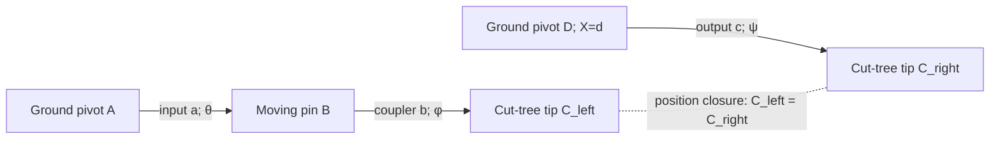
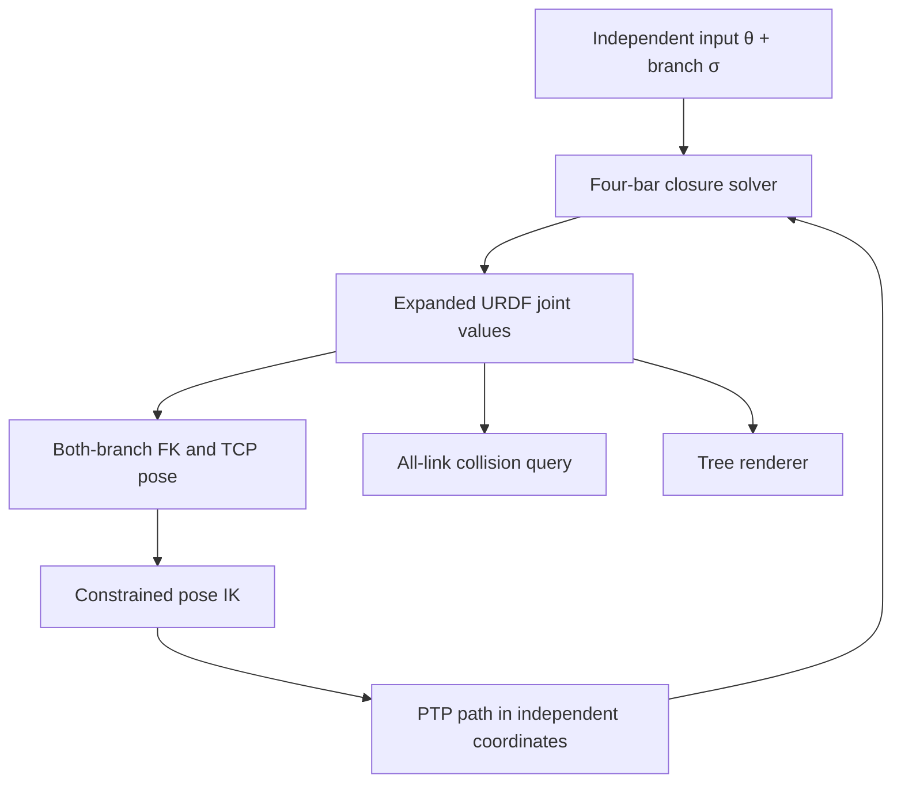

# Closed-loop mechanisms in the browser workcell: boundary and first implementation

Date: 2026-11-13. This is an implementation design, **not** a claim that closed-loop motion already works. The proposed first mechanism is a planar four-bar with one actuated revolute coordinate, two passive revolute coordinates, and a fixed assembly branch. It is kinematic: there is no constraint force, contact, or dynamics solver.

## Evidence that sets the boundary

- The current URDF loader requires each child link to have one parent and rejects cycles (`frontend/local-robots.js`, `validate`, lines around 185–210). `coffee/modelrobot.litcoffee` renders by parenting each child `THREE.Object3D` under its parent. A real graph cycle cannot be represented directly in that scene tree.
- `frontend/planning/robot-model.js` builds one acyclic base-to-TCP chain; `forwardKinematics` accepts one value per nonfixed joint on that chain. It rejects a mimic joint in the TCP chain. `frontend/planning/ik-pose.js` forms a serial Jacobian for that vector. `frontend/planning/collision-scene.js` computes all link transforms by walking a rooted tree and currently treats URDF mimic as an affine dependent value. None of these functions evaluates a nonlinear loop-closure equation.
- The SDF importer explicitly reports a model `<joint>` as `UNSUPPORTED_MODEL_ELEMENT` (`frontend/sdf.js`, around line 78). Current SDF scene import therefore cannot be used as a closed-link robot importer.
- EASY-ROB's [closed-loop investigation](../../notes/2026-11-12_closed_loop_kinematics.md) found special Delta and Tricept IK dispatch plus model-specific passive `attach_calc` frames. The evidence supports those geometry-specific routes; it does not establish a universal constraint solver. The [IRB540 conversion note](../../notes/2026-11-12_ir364_abb_conversion_update.md) also warns that nonlinear passive rods are not reproduced by standard URDF mimic expressions. This application can use a different algorithm, but it must keep dependent geometry and the solved active pose consistent.

## First mechanism and notation

Use a planar four-bar in the world XY plane. Ground pivots are $A=(0,0)$ and $D=(d,0)$, where $d>0$ metres. Link lengths are $a=|AB|$, $b=|BC|$, and $c=|DC|$, in metres. The independent input angle $\theta$ is the counterclockwise angle from +X to $AB$. Passive **absolute** angles $\phi$ and $\psi$ point along $B\to C$ and $D\to C$, respectively. Their corresponding cut-tree URDF joint values are $\theta$, $\phi-\theta$, and $\psi$; the distinction between absolute and relative angles must survive rendering and trajectory export.

Let $e(\alpha)=(\cos\alpha,\sin\alpha)^T$. The pin closure at $C$ is a **two-component position constraint**,

\[
g(\theta,\phi,\psi)=a e(\theta)+b e(\phi)-d(1,0)^T-c e(\psi)=0\in\mathbb R^2.
\]

This is not a six-dimensional pose equality: a revolute pin permits relative orientation between the coupler and output link. A spatial implementation would have to declare the joint's allowed relative twist rather than equating two full `SE(3)` frames.

The solid arrows above label physical link directions, not signal flow; the dashed edge is a geometric pin constraint. Both ground pivots are in the same rigid base. A URDF tree can render the two branches if it has distinct endpoint links `C_left` and `C_right`; the closure edge belongs to a companion constraint description, not to the URDF parent graph.

## Geometry-specific closure solve

For a given $\theta$, compute $B=A+a e(\theta)$, $r=\lVert D-B\rVert$, and the unit direction $\hat r=(D-B)/r$. Intersect the circle of radius $b$ about $B$ with the circle of radius $c$ about $D$:

\[
h=\frac{r^2+b^2-c^2}{2r},\qquad
k=\sqrt{b^2-h^2},\qquad
C=B+h \hat r+\sigma k R_{90}\hat r,
\]

where $R_{90}(x,y)=(-y,x)$ and $\sigma$ is the selected assembly branch, +1 or −1. Then $\phi=\operatorname{atan2}(C_y-B_y,C_x-B_x)$ and $\psi=\operatorname{atan2}(C_y-D_y,C_x-D_x)$, unwrapped continuously from the previous sample. Reject a configuration when $r\le\epsilon_r$, $r<|b-c|$, $r>b+c$, or $k\le\epsilon_k$. The last test avoids a toggle where the two branches meet and passive velocity can diverge. Check all three URDF joint limits after converting to relative values, and retain $\sigma$ through an entire plan and saved project.

For the first fixture, use non-parallelogram lengths $d=0.55$, $a=0.22$, $b=0.48$, $c=0.32$ m and a restricted input range 0.35–1.20 rad. An 86-point numerical check gives $r\in[0.3515,0.5131]$ m and $k\in[0.2916,0.3200]$ m, away from the circle-intersection toggles. These are proposed test values, not dimensions measured from EASY-ROB; the implementation must still validate the full continuous interval and joint limits.

## IK, timing, and collision contract

The model's **independent** configuration is $u=[\theta]$, while its expanded rendering/collision state is $q=[\theta,\phi(\theta)-\theta,\psi(\theta)]$. Every evaluated $u$ must expand through the closure solver. A target TCP pose is reachable only on this one-dimensional manifold. A first pose-IK implementation can search the permitted $\theta$ intervals on the selected branch, refine local minima with a bracketed scalar method, and accept only when both position and orientation residuals satisfy the existing tolerances. A requested straight LIN or CIRC TCP path will generally leave this manifold; it must fail with a path-specific diagnostic unless every required sample is feasible. The first useful motion lesson can therefore use `MOVEJ` and a pose PTP between two reachable four-bar states.

For a timed path, solving passive positions only at endpoints is insufficient. With $E=R_{90}$, the differential closure is

\[
\underbrace{\begin{bmatrix}b E e(\phi)&-c E e(\psi)\end{bmatrix}}_{G_p\in\mathbb R^{2\times2}}
\begin{bmatrix}\dot\phi\\\dot\psi\end{bmatrix}
=-a E e(\theta)\dot\theta.
\]

Away from toggles, solve this 2×2 system for passive rates. The rendered coupler joint rate is φ̇−θ̇; the output joint rate is ψ̇. Differentiate the same relation or use a checked analytic second derivative to enforce passive acceleration limits too. Retiming must consider **all three** joint speed/acceleration bounds, even though only θ is actuated. A ROS-shaped actuator command should contain the independent `input` joint; a separate expanded-state trace may record passive joints for visualization. Do not present passive joints as independently commanded axes.

The collision scene must expand $u$ to all joint values and compute transforms for both branches at every sampled state and edge. The closure endpoints are kinematically adjacent at the pin; collision filtering must account for that pair while still checking other self/scene pairs. Record the residual $\lVert p_{C_\text{left}}-p_{C_\text{right}}\rVert$ at every trajectory and rendered sample. This is a sampled kinematic check, not a continuous collision or force guarantee.

## Integration route, in dependency order

1. **Portable source:** retain a valid cut-tree URDF for links, visuals, collisions and joint limits. Add an explicit, versioned constraint descriptor in the project ZIP naming `input`, `coupler`, `output`, `C_left`, `C_right`, link lengths/ground separation (or derive those from URDF origins), and branch σ. A local descriptor is an application extension, not standard URDF. Later SDF robot-joint import can use a standard graph source, but current SDF world import rejects model joints.
2. **Model and solver:** add a constrained four-bar model beside the serial `createRobotModel`, with independent-to-expanded state, analytic closure, branch/toggle checks, world FK and TCP residual. Expose common FK/IK/query operations to `program-plan.js`; do not make the serial IK silently ignore passive links.
3. **Planning:** parameterize PTP in independent θ, expand every geometric and timed sample, and enforce active/passive limits plus collision. Add constrained pose IK on the selected branch. Reject infeasible LIN/CIRC at the first offending source line and path fraction.
4. **Rendering:** apply expanded joint values to the existing tree in parent-before-child order, hide passive sliders, and draw a small closure-error marker or status if the two tips disagree. Prevent manual, CSV, and direct-pose controls from setting passive joints independently.
5. **Persistence:** save independent θ and assembly branch; reconstruct/pass validation on open. The current `robot-state.json` validator treats every non-mimic URDF joint as independent, so it needs an explicit constrained-model path. Store the descriptor and branch in ZIP; avoid serializing passive angles as independent commands.

### Constraint descriptor sketch

~~~json
{
  "format": "modelrobot-kinematic-constraints",
  "version": 1,
  "mechanisms": [{
    "type": "planar-four-bar",
    "robot": "four_bar",
    "driverJoint": "input",
    "couplerJoint": "coupler",
    "outputJoint": "output",
    "leftClosureLink": "C_left",
    "rightClosureLink": "C_right",
    "branch": 1
  }]
}
~~~

Derive $a,b,c,d$ from validated URDF pivot and endpoint transforms rather than silently trusting duplicated lengths. Validate coplanar Z axes, rigidly shared ground, finite positive lengths, closure at the saved home state, joint names/types/limits, and exactly one supported mechanism before replacing the browser scene. This descriptor is a local extension; its type must not be treated as a generic SDF or ROS 2 loop constraint.

## Acceptance evidence for the implementation agent

- Unit checks: circle-intersection branch signs; closure residual under $10^{-6}$ m across a dense $\theta$ grid; passive joint limits; rejection of impossible lengths/toggles; continuous unwrapped angles and branch on forward/reverse moves; analytic-rate versus centered-difference agreement away from toggles.
- Planner checks: reachable pose target from a known θ is recovered on the intended branch; off-manifold pose and LIN/CIRC report typed failures; active and passive velocity/acceleration bounds hold; scene collision on either branch rejects the path; trajectory times increase strictly.
- Chromium: load the cut-tree URDF and constraint descriptor, play/step/reset a PTP, inspect both bars and the moving pin in top view, and verify the two cut-tree endpoint world positions agree at several frames. Save a screenshot and numeric trace in `notes/artifacts/`; reopen a ZIP mid-configuration and confirm branch, input coordinate, closed geometry, and program source.
- Regression: ordinary URDF serial robots and existing mimic grippers retain current behavior; unsupported loop descriptors fail before changing the visible scene.

**Notation check:** $A,B,C,D$ are XY positions in metres; $\theta,\phi,\psi$ are absolute planar angles in radians; $u$ is the independent coordinate and $q$ is the expanded URDF joint vector. The loop residual is position in metres. $G_p$ maps passive angular rates to closure-point velocity in m/s; a near-singular $G_p$ is a toggle diagnostic. This note uses the Modern Robotics transform/frame direction convention where needed, but its planar closure equation is written directly in world coordinates. No dynamics or constraint forces are claimed.
