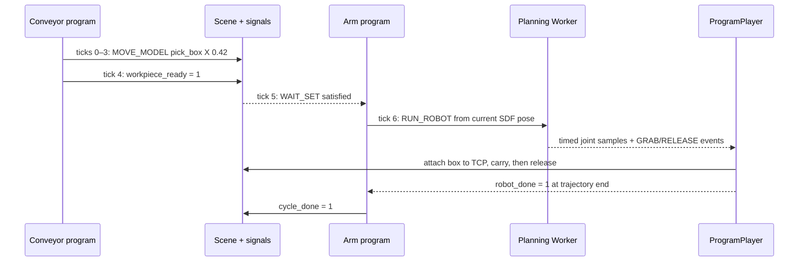

# Device-first workpiece delivery and robot pick/place (2026-11-13)

The browser fixture reuses [`testowe/workcell/arm.urdf`](../testowe/workcell/arm.urdf) and adds [`delivered_world.sdf`](../testowe/multi_program/delivered_world.sdf), [`delivered.mprg`](../testowe/multi_program/delivered.mprg), and [`delivered.robot`](../testowe/multi_program/delivered.robot). It exercises the command-time controller, actual planning Worker, and `ProgramPlayer` in one Chromium run. The repeatable probe is [`check_delivered_workpiece.cjs`](scripts/check_delivered_workpiece.cjs), invoked by [`delivered-workpiece-browser.test.cjs`](../tests/delivered-workpiece-browser.test.cjs).

The SDF has a detached non-static `pick_box` centered at (0.20, 0.16, 0.765) m. The concurrent `conveyor` program moves its **world X origin** to 0.42 m in four logical ticks and sets `workpiece_ready`. The `arm` program waits for that signal, requests `RUN_ROBOT`, then waits for the reserved read-only `robot_done` signal. The movement source commands `MOVEJ pick`, `GRAB pick_box`, `MOVEC via place_approach`, `MOVEL place`, and `RELEASE pick_box`. The signal fixture's `TIMEOUT 500` gives the default 0.1 s tick enough time for the robot trajectory; it denotes logical ticks, not seconds.

## Measured browser evidence

`node --test tests/delivered-workpiece-browser.test.cjs` passes in Chromium. The test captures the actual Worker request and finds `pick_box` at (0.42, 0.16, 0.765) m, with the robot at its original joint configuration. The robot plan begins at command time 0.7 s, lasts 11.9947228 s in the current planner, and carries `GRAB` at local 6.5411411 s and `RELEASE` at local 11.9947228 s. At triggered time 7.3 s, `attachmentRecords()` and the Workcell object list both show `pick_box → robot/classroom_six_axis_arm/link/tcp_link`. The box subsequently moves more than 0.1 m while attached. At completion, the detached box center is (0.839917, −0.159991, 0.785023) m on the destination. `robot_done` and `cycle_done` are both one. Reset removes the attachment and returns the box to (0.20, 0.16, 0.765) m with the arm at its initial joint state. There were no JavaScript page errors.

The archived [JSON state and event evidence](artifacts/delivered_workpiece.json) includes initial, delivery, Worker snapshot, GRAB, carry, final, and reset states. Screenshots show [delivery in progress](artifacts/delivered_workpiece_mid.png), [the carried workpiece](artifacts/delivered_workpiece_carried.png), and [the placed workpiece](artifacts/delivered_workpiece_placed.png). The source files are also independent fixtures for later browser examples.

`MOVE_MODEL` directly changes a detached SDF model pose on the scheduler's logical clock. It is a kinematic representation of delivery, with no conveyor mesh motion, contact friction, payload dynamics, or external device I/O. The planner receives the post-delivery scene at `RUN_ROBOT`; this test does not assert physical feasibility of the conveyor transport itself. Only one triggered robot plan is supported in a run.
