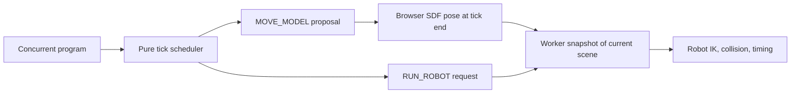

# Review: scene-device motion and command-time robot planning

Date: 2026-11-13. Scope: read-only audit of the browser workcell's `MOVE_MODEL` and `RUN_ROBOT` path after the 180-test baseline. No implementation change was made by this review.

## Current route

`MOVE_MODEL name X|Y|Z coordinate TICKS N` changes an SDF model's world origin at logical tick boundaries. The parser/scheduler store only XYZ; `applySceneDevices` preserves orientation. `stepTriggeredClock` rejects a device command while a robot trajectory is active, and a `RUN_ROBOT` request freezes the clock while the Worker plans from the **currently rendered** robot joints and SDF poses. Sequential requests therefore replan after device movement. A model touched by robot GRAB/RELEASE/JOIN must be synchronized from the rendered scene before later device movement.

## Actionable gaps

1. **Device translation has no collision check.** `frontend/multi-program-scheduler.js` interpolates a model's origin numerically, and `frontend/device-motion.js` applies it without testing shapes. A device can pass through a wall and finish clear, or finish inside another detached SDF model. The existing `createPlanningCollisionScene.isStateValid(q)` in `frontend/planning/collision-scene.js` checks scene-scene pairs only when at least one model is attached to the robot or another model, so it does not cover ordinary detached device collisions. Its robot-scene checks run for robot planning, not for a device-only tick.
   A direct Node reproduction loaded a movable 0.2 m box at X=0 and a static 0.2 m wall at X=0.5, then stepped `MOVE_MODEL tray X 1 TICKS 1`. It returned `status: finished` and placed the tray at X=1 despite crossing the wall.
2. **A same-tick device move and `RUN_ROBOT` can commit the device before a robot planning failure.** `stepTriggeredClock` permits the combination when no robot trajectory is active; `workcell-ui.applyTriggeredResult` then applies the device pose, and `planTriggeredRobot` snapshots that moved scene. If it creates a colliding robot start, the Worker rejects the robot request after the device tick has already committed. This is deterministic, but it is not an atomic collision-safe device step.
3. **An independent carrier is not yet a durable robot base mount.** `SceneModel.attach` attaches SDF objects to frames, not robot roots. Parenting `window.robot` directly under a movable SDF frame would be unsafe: `SceneModel.loadWorld` clears its SDF layer; triggered reset snapshots only SDF world, SDF attachments, and joint values; project ZIP attachments describe only SDF object relationships. The collision planner has no robot-to-carrier mount relation or corresponding allowed-contact exclusions. The Worker does use the robot root's live `matrixWorld` as `worldFromBase`, so a designed mount could feed the existing serial IK, but lifecycle, collision, and persistence must be added together.

## Recommended next vertical slice: precommit device sweep

Add a detached collision query for a **whole logical tick**. It takes the current and proposed XYZ maps, current stationary robot joint vector, and the models moved by that tick. At a common interpolation fraction for all moved devices, update local collision records for the proposed world transforms, including rigid SDF descendants of moved parents. Test moving assemblies against the robot, static models, and other moving assemblies; exempt only pairs in the same declared rigid assembly. Restore local records after the query. The query must not mutate the live viewer. Use an explicit translation sampling step and sample budget; report the same between-sample limit as robot planning.

Run this check before scheduler state and scene poses are committed. A read-only proposal-validation callback on `stepMultiProgram` could keep its deterministic tick semantics while allowing the browser collision scene to decide validity. Wire the same validator into the signal-only lab, shared clock, and command-time clock so `MOVE_MODEL` has one rule across modes. On rejection, retain old model poses and clock state, and report `DEVICE_COLLISION` with the moving command's program and line. A simultaneous pair must be checked at the same fractions, not each device in isolation: two models can cross despite both individual endpoint poses being clear.

Focused tests should cover: a box crossing a thin static barrier with a clear endpoint; endpoint overlap; two devices crossing in one tick; a rigid child following a movable parent; a robot collision; a clear move; source-located rejection with no state/scene mutation; and sample-budget exhaustion. Chromium should show the last safe device pose, an error at the blocked tick, and Reset restoring the baseline. The trace should include the tested transforms and the rejection line. A true robot-on-carrier mount is a separate follow-up after mount semantics and persistence are specified.
