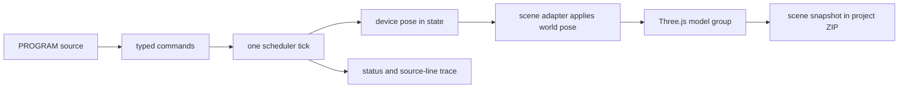

# Device-motion integration review — 2026-11-13

## Current code boundary

`frontend/multi-program-language.js` compiles `PROGRAM` blocks to typed commands with source lines. `frontend/multi-program-scheduler.js` keeps one counter per program and shared numeric signals. Each tick reads a signal snapshot, allows one command per program, then commits writes. `frontend/workcell-ui.js` exposes Step/Run/Reset but currently uses the signal scheduler only. `frontend/scene-model.js` owns SDF model groups, and `SceneModel.snapshotWorld()` exports their current world poses. These are the relevant code paths for a device move.

## Proposed narrow command

The chosen initial integration is a typed command within a program:

```text
MOVE_MODEL conveyor X 0.80 TICKS 5
```

Here `conveyor` is an SDF model name; `X` is one of `X|Y|Z`; `0.80` is an absolute **world** coordinate in metres; `5` is a positive safe integer count of logical ticks. The target replaces only that world-position component. Other world-position components and orientation stay fixed. This is a kinematic scene transform, not a simulated drive, contact, motor, or controller. `SET` and `WAIT_*` commands can still orchestrate device and robot-named programs using the same scheduler. It does not yet make a `robot` program move the URDF arm.

The parser should produce a distinct `{kind:'MOVE_MODEL', model, axis, target, durationTicks, line}` object. The scheduler should normalize it and include motion state in its own serializable state, rather than infer motion from a signal name. A program's PC stays on that command during the move and advances on completion. Define duration unambiguously: if dispatched on tick `k` with `N` ticks, after tick `k+j-1` its coordinate is `start + (target-start)*j/N` for `j=1..N`; the PC advances when `j=N`. The next command may run on tick `k+N`. This gives exact endpoint state and a replayable trace. A paused program can be resumed by stepping its retained state. A Run control should repeatedly call the same step path as Step; a bulk scheduler result alone cannot update visible intermediate poses.



## Validation and ownership

- Validate the model name against `SceneModel.models` before starting. An absent model should produce a source-line diagnostic. Validate finite target and positive safe tick count at parse time; validate scene-dependent conditions at execution setup.
- Reject `<static>true</static>` models for this command. SDF marks them fixed; the parser retains `model.static`, so `SceneModel.world.models` can answer this. A `<static>false</static>` model remains kinematic in this app: `frontend/sdf.js` warns that physics is ignored.
- Reject a moved model if it appears as a child in `SceneModel.attached`. Moving an attached group would turn the world target into a parent-local transform and compete with GRAB/WELD relationships. Attached children of an otherwise free moved model can travel with it.
- If two programs command the same model in one tick, report a model-motion conflict with both source lines and commit neither move. Define what happens if an active move and a second program request the same model; reject it rather than silently changing the target. Independent models may move concurrently.
- Motion in progress counts as scheduler progress. The existing deadlock rule assumes only a signal write can make an untimed WAIT advance; it must not declare deadlock while a model move can finish and let its program later write a signal. Timeouts on other programs still count logical ticks during the move.
- Before applying the first scene move, pause/invalidate any preplanned robot trajectory through `WorkcellUI.invalidatePlan()`: its collision scene may now be stale. Rendering should use `SceneModel.getObject(model)`. Since the target is in world coordinates, convert to the object's parent frame or explicitly require the model to remain under the identity world layer; raw `setSDFPose(group, worldPose)` treats its argument as parent-local.
- The adapter should set a model group pose from scheduler state and let Three.js update the visible scene. Collision entries are child objects of the model group, so they follow the move; a future robot plan then sees the new obstacle position. This command does not collision-check the device's own sweep, so the UI should label it kinematic scene motion.

## Reset, scene reload, and project ZIP

Capture the initial world pose of each commanded model when a fresh run starts. **Reset** returns both the scheduler to tick zero and these scene models to that baseline. Editing the signal source, applying new SDF, opening a project, or loading a demo invalidates the old device state; otherwise a later Step could apply stale coordinates to a new scene. If source is edited mid-move, restore the run baseline before discarding state, or explicitly establish the current pose as a new baseline and display that choice.

`createProjectZip()` currently calls `serializeSDF(this.sceneModel.snapshotWorld())`, so saving after a move archives the *current* model pose. The optional `signal-programs.mrl` archives source, not tick/PC/in-flight movement. On reopen, the new baseline is the pose in the saved SDF and program execution begins at tick zero. A target expressed as an absolute world coordinate might already be reached and therefore yield a zero-displacement move. This behavior should be documented and covered by a ZIP round-trip browser test. No new project manifest entry is required for this single command.

## Useful focused checks

Test parser errors, N-tick coordinate sequence and PC retention, concurrent independent moves, same-model conflict, untimed WAIT alongside active move, timeout alongside active move, static/attached/unknown model rejection, Reset, SDF reload, and project reopen. A browser probe should step one tick, inspect both scheduler state and the rendered model world position, then Run to endpoint and inspect a screenshot. Current `tests/signal-lab-browser.test.cjs` already provides the local Chromium and ZIP round-trip pattern.
