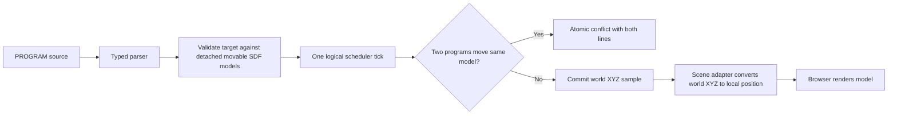

# Kinematic SDF model motion in the multi-program lab — 2026-11-13

## Scope and syntax

The signal-program language now accepts a typed, single-axis scene command:

```text
PROGRAM conveyor
MOVE_MODEL tray X 0.65 TICKS 4
SET conveyor_done 1
END
```

`tray` is an SDF model name. `X`, `Y`, or `Z` names a **world** translation axis; the numeric coordinate is an absolute target in metres. `TICKS` takes a positive safe integer. The model retains its orientation and the other two world coordinates. The parser emits a command object, never evaluates a script expression, and reports malformed arguments at their source line.

Only a detached SDF model with `static=false` is eligible. `captureSceneDevices(sceneModel)` returns an object mapping each eligible model name to its initial `[worldX, worldY, worldZ]` origin. `createMultiProgramState({ programs, signals, devices })` checks each `MOVE_MODEL` target against this map; an unavailable name raises a message containing the program and source line. `applySceneDevices(sceneModel, state)` checks the targets again before applying any translation; it rejects a model that became attached, static, missing, or has invalid coordinates. It converts the world target to the model's parent-local position and preserves orientation.

## Logical-tick behavior

At each scheduler tick, every program executes at most one command. A model move occupies its program for `N` ticks; tick `k` sets its commanded axis to

\[
q_k=q_0+\frac{k}{N}(q_\mathrm{target}-q_0),\qquad 1\le k\le N.
\]

The following command in that program starts on the next tick. Programs retain separate counters. Shared signal reads use the start-of-tick snapshot and writes commit together at tick end. A model's position also commits at tick end. Two programs commanding the same model in one tick yield `DEVICE_WRITE_CONFLICT`, both source locations, and no partial signal or device changes for that tick. Different model names can advance concurrently.



This is deliberately kinematic: a tick has no fixed wall-clock duration, no acceleration or collision checking, no contact dynamics, and no physical device I/O. It is an instructional scene-device programming path, separate from the existing timed robot trajectory player. A later adapter can map logical ticks to a clock and add motion limits or interlocks.

## Evidence

- `tests/multi-program-language.test.cjs` checks typed parsing and rejects expression-like coordinates, invalid axes, and nonpositive ticks.
- `tests/multi-program-scheduler.test.cjs` checks four-step interpolation, immutable prior state, terminal signal ordering, missing targets, and atomic concurrent-driver diagnostics.
- `tests/device-motion.test.cjs` applies a four-tick move under a rotated scene parent, verifies world X while world Y/Z and orientation remain fixed, verifies reset, and checks static/attached rejection before mutation.
- Focused run: `node --test tests/multi-program-scheduler.test.cjs tests/multi-program-language.test.cjs tests/device-motion.test.cjs` passed 18/18.

## Browser workflow and project behavior

The Program tab has a **Load conveyor scene + program** example. It loads `testowe/multi_program/conveyor.sdf` and `conveyor.mprg`; the `feeder` program sets `start`, then waits for `arrived`, while `conveyor` waits for `start`, moves `tray` from world X 0.20 m to 0.65 m in four ticks, and sets `arrived`. **Step tick** applies each committed pose to the Three.js scene, and **Run program** advances at most 1000 ticks. **Reset run** restores the scene pose captured when the run began. Changing source begins a new run from the current scene pose. Loading another SDF invalidates the run and its baseline.

The workcell invalidates any previously planned robot trajectory before starting a device program, because a moved scene object would make that plan stale. The device program does not command the robot. Project ZIP export saves the scene's current model pose through the normal SDF snapshot and saves editable concurrent-program source; reopening starts at tick zero at that saved pose.

The Chromium probe `notes/scripts/check_device_motion.cjs` loads the six-axis arm and conveyor example, steps to the first motion tick, runs to completion, resets, exports and reopens a ZIP. It asserts world X 0.20 → 0.3125 → 0.65 → 0.20 → 0.65 m and no page errors. The [mid-move image](artifacts/device_motion_mid.png), [final image](artifacts/device_motion_final.png), and [numeric result](artifacts/device_motion.json) are archived; `tests/device-motion-browser.test.cjs` runs the probe.
