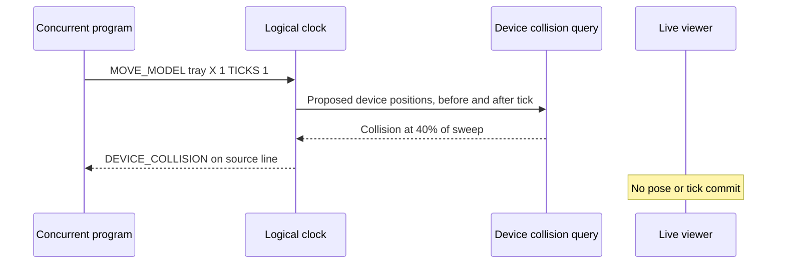

# Browser proof: scene-device swept collision gate

The reviewer reproduced a wall-crossing gap in the old `MOVE_MODEL` runtime. The fixture `testowe/device_collision/world.sdf` places a movable tray at world X=0 and a static wall at X=0.5. A one-tick command to X=1 has clear start and end poses but crosses the wall. The Playwright script `notes/scripts/check_device_sweep_browser.cjs` runs this case through the signal lab, the shared preplanned robot clock, and the command-time triggered robot clock. Run `node --test tests/device-sweep-browser.test.cjs` after `npm run build`.

All three modes now reject the proposal before committing the scheduler state or viewer pose. The tray remains at X=0. Signal mode returns typed `DEVICE_COLLISION` on source line 2; shared mode reports source line 3 after the robot completes; triggered mode reports source line 2 and remains at tick 0, before its `RUN_ROBOT` request. The collision is detected at 40% of the proposed tick motion. Chromium reports no page errors. Numeric evidence is `notes/artifacts/device_sweep_browser.json`; I inspected the blocked scene and source-located status in `notes/artifacts/device_sweep_signal_blocked.png` and `notes/artifacts/device_sweep_triggered_blocked.png`.

The collision query checks all same-tick model translations at common interpolation fractions, including rigidly attached descendants and any robot mounted on the moving model. The current step is 0.005 m and the maximum is 2000 samples. This is an explicit sampled check; thinner geometry between samples can still be missed. Device motion remains kinematic with constant per-tick position increments and no force, friction, velocity, or acceleration model.

