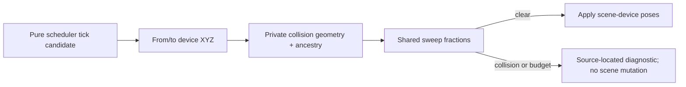

# Sampled collision query for scene-device translations

`createSceneDeviceCollisionQuery` in `frontend/planning/collision-scene.js` takes the current `SceneModel`, an optional registered robot and its explicit URDF collision shapes, and a mesh resolver. It builds private collision geometry and snapshots the current world matrices. The returned `checkSweep(fromDevices, toDevices, options)` checks synchronized, linear world-XYZ translations of detached nonstatic SDF model origins. It does not alter live Three.js object poses; `dispose()` frees the private geometries.

The input maps name each moved model (or include unchanged former devices) with three finite world coordinates. For a **changed** model, the start coordinates must match the viewer at query creation to within $10^{-7}$ m, and the model must be detached and nonstatic. An unchanged entry can have stale scheduler coordinates after `GRAB`; its live collision shape is still considered stationary and can block another device. The keys must agree in both maps. The query must be created again after the scene changes, SDF reloads, robot q changes, an attachment changes, or a mount changes. It is intended for one proposed scheduler tick before applying that tick to the viewer.

For each collision shape, the query walks its live parent chain at snapshot time to identify whether a moved SDF model carries it. Thus a model attached under the carrier, or a URDF root parented to the carrier, inherits the carrier's translation. Shapes under the same translation are internal to that moving assembly and retain their relative pose. All candidate pairs with different translations are checked at shared fractions $s=k/N$, $k=0,\ldots,N$. The number of intervals is

$$N=\max\left(1,\left\lceil\frac{\max_{(a,b)}\lVert\Delta_a-\Delta_b\rVert}{h}\right\rceil\right),$$

where $\Delta_a$ is a shape's inherited world translation, the maximum is over candidate collision pairs, and $h$ defaults to 0.005 m. This uses **relative** motion, so two devices moving toward one another receive enough samples. `maxSamples` defaults to 2000 intervals; an over-budget request returns `sample_budget` before checking or changing any scene pose. The result is `clear` or `collision` with the source model, opposing shape label, pair, and first detected fraction. The query reuses the existing OBB/BVH/primitive intersection logic and its 1 µm contact tolerance.

Focused tests in `tests/device-swept-collision.test.cjs` passed 8/8. They check an obstacle between clear endpoint poses, opposing and parallel same-tick device motions, an attached model descendant, a robot mounted below the moving SDF carrier, a stationary robot blocker, stale/static/budget rejection, and both clear and blocked sweeps past an unchanged tool-held object. The mounted robot test also verifies that the query leaves its rendered root in place. This is a sampled collision screen for translation-only device motion, not a continuous certificate or a dynamics/force simulation. It does not impose device velocity or acceleration limits.

The runtime should call `checkSweep` after `stepMultiProgram`/`stepTriggeredClock` produces the proposed next device coordinates and before `applySceneDevices` commits them. If any scene event, mount change, or robot joint update has occurred since query creation, create a fresh query first. Because the query is synchronous, a large but in-budget sweep may briefly use the UI thread; a future Worker version can reuse the same pure input and status contract.
