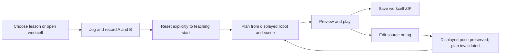

# Educational workflow and real robot repairs

The user requested independent review of clarity, educational value, correctness, and state presentation, followed by repairs. Three reviewers examined pedagogy, workflow, and numerical/manual control; a fourth review used Astra. Individual evidence and remaining limitations are in the corresponding education, workflow, state, and Astra review notes.

## Student route

The desktop header now offers **Start programming**. Program's **Teach two poses** lesson loads a clean six-axis workcell with a bent, collision-clear start. It opens the pendant, collapses raw source, and guides recording A, jogging to B, recording B, explicitly resetting to the teaching start, then Plan and Play. The reset is instantaneous; it is not a planned robot movement. **Explore pick-and-place** instead introduces MOVEJ, MOVEL, MOVEC and GRAB/RELEASE. Raw source, export, pose input, and device labs remain available through disclosures.

## State and numerical repairs

- Persistent plan lifecycle and current Cartesian motion condition are separate from the last action message. Source TOOL and jog TCP selection have distinct explanations. Source edits and replanning preserve the displayed pose by default; explicit Reset restores a plan baseline.
- Jacobian health uses an explicit normalized task scale (0.25 m), reports near-singular conditioning, and distinguishes a low-DOF task restriction from rank loss. A regular chain unable to achieve an arbitrary twist is no longer automatically called singular. This is a local geometric diagnostic with chosen thresholds, not a universal robot capability or safety metric.
- Failed jogs retain requested/achieved velocities and residuals, state that the robot was unchanged, and offer Joint mode for posture recovery. Collision blocks name the involved owners. The viewer checkbox is labelled as collision warnings; planned and pendant movement always use their blocking collision query.
- Feasible Cartesian directions are automatically slowed when joint rate/one-step bounds constrain the request. Scaling preserves the requested direction; a bounded approximation with a different direction is not applied. Speed scaling stops at 1/32; unattainable directions still fail. Manual joint speed is capped at 0.3 rad/s or 0.05 m/s, with actual rate and per-click increment shown. J7 and further axes are available through paging.
- Astra demonstrated a fundamental finite-step error: an instantaneous Jacobian solution is insufficient to justify a large finite Cartesian jog. Adaptive integration now recomputes local velocities in substeps of at most 10 ms, checks each FK increment, and collision-checks the integrated joint polyline before applying any result. Failure is atomic. Diagnostic residuals are time averages of instantaneous velocity tracking, not a global endpoint error certificate.
- The pick-and-place example now starts bent at q=[0,-0.3,0.6,0.2,-0.3,0.2], verified collision-clear and full local rank, instead of the all-zero straight posture. Straight-posture singularity is tested deliberately as a separate recovery exercise.

## Real robot trials

1. KUKA LBR iiwa: archived expanded seven-axis URDF and local STL meshes from the pinned Bullet repository. Browser tests cover all jog modes, the seventh axis, and a blocked direction at a straight configuration. The source model's 10 rad/s limits exposed why raw percentage overrides need a teaching cap. See `2026-11-13_kuka_real_model_review.md` and `testowe/imported_robots/kuka_iiwa/README.md`.
2. UR5: archived official Universal Robots ROS 2 description inputs at a pinned revision. Browser tests cover local mesh import and Joint/World/Tool motion. Six vendor binary STL files had zero normals; the shared importer now reconstructs missing/invalid normals from unchanged triangles, repairing black rendering. See `2026-11-13_official_ur5_browser_trial.md`.

The current viewer supports STL mesh assets. Both ready-to-import derivatives use upstream collision STL surfaces as visible geometry; original kinematic chains, limits, transforms and collision geometry are retained. Original OBJ/DAE visual assets are archived/referenced but are not represented as supported raw imports. Sources, licenses, exact adaptations, and reproducible preparation scripts accompany the fixtures. These trials exercise imported-model behavior, not manufacturer calibration or hardware control.

For a one-file classroom trial, open `notes/artifacts/kuka_iiwa_teaching.workcell.zip` or `notes/artifacts/official_ur5/ur5_teaching.workcell.zip` using **Workcell → Open project ZIP**. These packages include bent poses, local meshes, and an actual two-target taught program with matching ROBOT/TOOL commands. Both real-model browser trials record A, jog to B (J7 on KUKA, J1 on UR5), record B, explicitly restore A, plan and play to the exact recorded B, then Reset to A and export. Their tests reopen the ZIP and check exact source, joint state, and asset restoration. The KUKA's two moves take 0.087702 s; UR5's take 0.179549 s for these small teaching increments. KUKA source: <https://github.com/bulletphysics/bullet3/blob/d3afe76132fc76b0f9b2359cbaef47a3766e7fbb/data/kuka_iiwa/model.urdf>. UR5 source: <https://github.com/UniversalRobots/Universal_Robots_ROS2_Description/tree/3852128295499b52f38f82171f5ff3f21ecdfa22>.

## Verification and limits

`tests/learning-workflow-browser.test.cjs` covers recording, explicit start, planning, actual playback, editing at mid-preview without rewind, blocked Cartesian motion, and Joint recovery. Numerical integration, Jacobian health, imported KUKA and official UR5 browser regressions complement the existing planner suite. Screenshots and JSON traces are under `notes/artifacts/`.

The repaired build passes **236/236** tests (`notes/artifacts/test_review_repair_complete.log`). The browser lesson's initial screen is `notes/artifacts/learning_start.png`. Full source, CSS and test whitespace checks pass; generated shader text and captured logs retain upstream/output formatting.

The app remains a kinematic classroom simulator. It has sampled collision checks and a discrete manual jog loop, not an acceleration-controlled robot servo, contact dynamics, certified collision avoidance, or calibrated manufacturer controller behavior. The bounded damped velocity clamp is a heuristic, not a globally optimal QP solver for arbitrary redundant chains. A broad imported-mechanism capability audit and OBJ/DAE visual loading remain further work.
