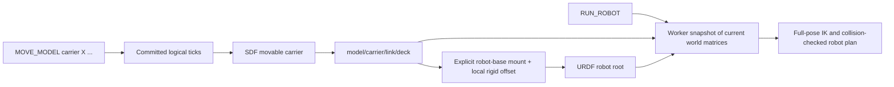

# Independently driven scene carrier for the robot base

## Intended case

An SDF model `carrier` has `<static>false</static>` and a named link frame. The Workcell panel explicitly mounts the loaded URDF robot base to `model/carrier/link/deck`. A concurrent program moves `carrier` with `MOVE_MODEL carrier X 0.4 TICKS 4`; after it finishes, `RUN_ROBOT` plans the frozen movement source from the robot's now-shifted base. The carrier's X command is a kinematic scene-device command, not a URDF joint or physical servo. Robot and carrier may not move simultaneously in this first case.

This is separate from the tested serial URDF rail in `notes/2026-11-13_external_rail.md`: the carrier is an SDF model controlled by the concurrent scheduler. The robot joint trajectory does not include a carrier joint. The program trace must therefore include both the carrier tick positions and the robot trajectory, rather than presenting the latter alone as a coordinated external-axis controller.

## Explicit configuration and persistence

Add a Workcell setting labelled **Robot base frame**, with `world` and available `model/<name>` or `model/<name>/link/<link>` choices. The selected frame and a rigid local offset are scene configuration, not an implicit side effect of `MOVE_MODEL`. On selection, preserve the robot's current world pose by default: let ${}^{W}T_B$ be its current root transform and ${}^{W}T_F$ the selected frame transform, then store ${}^{F}T_B=({}^{W}T_F)^{-1}{}^{W}T_B$. The UI may offer an explicit “align base to frame” action later; that would set ${}^{F}T_B=I$.

Store one optional mount record `{ frame, localPose: { position: [x,y,z], quaternion: [qx,qy,qz,qw] } }`. Validate finite values, unit-normalize the quaternion, reject nonrigid transforms and unknown frames, and reject mounting to a robot frame or an SDF model attached to the same robot (scene graph cycle). `world` means no SDF parent. Keep the record in `SceneModel` or `WorkcellUI`, with a single `mountRobotBase`/`unmountRobotBase` API so reparenting is not scattered across event handlers.

The portable ZIP should have optional `robot-mount.json` referenced by `project.json` (version 1 compatible, absent means `world`). Validate its frame against the parsed SDF and its rigid pose before replacing the current project; restore it after SDF and URDF load and after robot joint positions. The SDF preserves the carrier's world pose, while the mount file preserves the robot's transform relative to it. A reopened mid-carrier or post-carrier project then has the same robot world base and TCP pose. The project still does not archive a paused controller tick.

## Existing code route and required edits

1. `frontend/scene-model.js` already registers SDF model/link frames and URDF robot frames, but `attach()` reparents only SDF models. Add a separate robot-base mount record and parent operation. `SceneModel.clear()`/`loadWorld()` must detach the URDF root to the scene before destroying SDF groups, then reapply the mount to the newly loaded frame. `SceneModel.removeRobot()` and URDF reparse must also unmount the old root before `window.clearall()`.
2. `frontend/device-motion.js` already moves detached, nonstatic SDF model groups at committed ticks. A mounted carrier remains a detached SDF model in this sense, so `captureSceneDevices` and `applySceneDevices` should continue to include it. Moving its group automatically moves a parented URDF root in the browser. Assert that the stored parent/frame relation still holds after each application.
3. `frontend/triggered-clock.js` already rejects every `MOVE_MODEL` while a robot trajectory is active. Keep this rule. At a `RUN_ROBOT` request the clock freezes while planning, so the carrier pose cannot change during the Worker request.
4. `frontend/planning/snapshot.js` already sends `robotRoot.matrixWorld` and current SDF model, frame, and collision matrices to the Worker. `frontend/program-plan.js` builds the IK model with `worldFromBase: robotRoot.matrixWorld`. Thus no new IK solver branch is needed; do not reconstruct the base from stale SDF source poses. A moved carrier should change the Worker snapshot hash/transform and the planned world TCP path.
5. `frontend/workcell-ui.js` must keep mount state through `applySDF`, `onRobotLoaded`, `resetTriggeredRun`, `openProject`, and project ZIP export. In particular, `resetTriggeredRun()` calls `sceneModel.loadWorld(baseline.world)`, which currently replaces the carrier object. The reset baseline must include the mount record, or scene reload must reapply the persistent record before restoring q/attachments.
6. `frontend/project-bundle.js` should validate and archive the optional mount record. Existing ZIPs remain readable without it. The Workcell list/status should show `robot base → model/carrier/link/deck` so the mounting relation is visible.

## Collision and timing contract

The present `MOVE_MODEL` path is only a sequence of world-axis positions. It does not check carrier collisions, robot sweep, velocity, acceleration, or a device limit. If the URDF root rides the carrier, applying those positions without a gate could move the robot through an obstacle before `RUN_ROBOT` performs its otherwise correct collision check. Do not label this as collision-checked external-axis motion based solely on the subsequent robot plan.

For a robust first implementation, validate each pending carrier tick **before** committing it: interpolate the candidate carrier/model and mounted robot poses from the prior committed position to the next one at a documented maximum translation step (for example, at most 5 mm), holding robot joints fixed. At each sample, rebuild or update the planning collision scene with the candidate carrier transform and call its `isStateValid(q)`, plus scene-object collision checks. Reject the tick atomically with a source-located `DEVICE_COLLISION` diagnostic if any sample is invalid. A safe mount contact exception may exclude only the carrier's specified deck shape against the robot's base link; the arm must still collide with the carrier. The interval check is sampled, so disclose its resolution. The current `stepTriggeredClock()` is pure; its returned candidate can be preflighted before `applyTriggeredResult()` mutates the viewer. An asynchronous Worker check would freeze visual time during preflight, as robot planning already does.

If that collision gate is deferred, expose the mount only as a clearly marked kinematic demonstration and reject mounted-carrier `MOVE_MODEL` in the main collision-checked runtime. Otherwise the UI would silently weaken D-07 and D-20's planning claims. Add optional carrier velocity/acceleration bounds when evolving this into a true independent-axis trajectory; current `TICKS N` is constant position increment per tick with abrupt start/stop.

## Acceptance evidence

- Unit test mount transform composition, orientation, forbidden cycles, and SDF reload/reset preserving the local offset.
- A browser fixture with a visible carrier/deck and robot. Record the base and TCP world positions at carrier ticks 0, 2, and 4; they should translate with the carrier while robot q remains fixed. `RUN_ROBOT` must use a Worker snapshot with the shifted `worldFromBase`, produce a different world-target IK plan than before carrier movement, and reach the commanded TCP pose. Inspect screenshots mid-carrier and during robot motion.
- Test that robot-active `MOVE_MODEL` remains rejected and an unsafe carrier sweep fails before any scene mutation. Test pause/step/reset, ZIP export/reopen, and frame/offset restoration. Check no page errors and no network dependence.

## Open boundary

This proposal does not solve loop constraints, independent multi-robot control, real actuator I/O, or simultaneous robot-plus-carrier planning. Those need a joint scene-kinematics graph and a time-aligned collision query over all moving bodies, rather than one fixed `worldFromBase` per robot plan.
