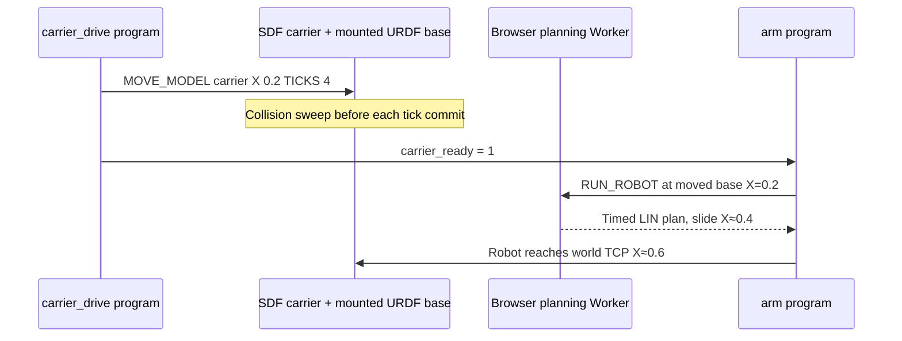

# Browser proof: independently programmed SDF carrier

This example uses `testowe/external_carrier/world.sdf`, the three-axis gantry URDF in `testowe/zone_orientation/robot.urdf`, `testowe/external_carrier/program.robot`, and `cycle.mprg`. The SDF carrier is a separate movable scene model. In the Workcell selector, its deck frame is selected as the URDF robot base frame. The relative mount offset is `[0,0,0.15]` m with identity rotation, preserving the robot's original world pose. The carrier includes a collision bracket intentionally overlapping the fixed URDF base collision; the declared mount treats those two fixed members as one assembly while moving links still collide with the carrier.

The Playwright probe is `notes/scripts/check_external_carrier_browser.cjs`, wrapped by `tests/external-carrier-browser.test.cjs`. It inspected the rendered workcell at the halfway carrier tick and after the robot trajectory; screenshots are `notes/artifacts/external_carrier_mid.png` and `notes/artifacts/external_carrier_robot_done.png`. The numeric trace, including mount and reopened project data, is `notes/artifacts/external_carrier_browser.json`. No browser page error occurred.

| State | Carrier world X | URDF base world X | Robot slide X | TCP world X |
|---|---:|---:|---:|---:|
| Prepared | 0 | 0 | 0 | 0 |
| Carrier tick 2 of 4 | 0.100000 | 0.100000 | 0 | 0.100000 |
| At `RUN_ROBOT` request | 0.200000 | 0.200000 | 0 | 0.200000 |
| Robot complete | 0.200000 | 0.200000 | 0.399991 | 0.599991 |

At the request, the Worker plan's `worldFromBase` translation is X=0.2 m, proving that it used the moved carrier rather than the original robot base. The final TCP is approximately `(0.599991,0.099998,0)` m for the commanded world pose. `cycle_done=1` after the planned robot finishes. Triggered Reset returns the original carrier and robot base to X=0 while retaining the mount. A downloaded project ZIP contains `robot-mount.json`; reopening the completed project restores carrier and robot base X=0.2, the final robot joint state, and TCP pose. A same-URDF reparse preserves the mount, while applying an unrelated empty SDF unmounts the robot and preserves its current world pose.

The carrier has kinematic position steps, with a sampled 5 mm swept collision check. It is not represented as a joint in the exported robot `JointTrajectory`; the concurrent event trace carries its positions. Carrier velocity and acceleration are not constrained, and robot and carrier cannot move simultaneously in this runtime.
