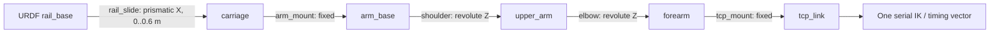

# Serial external rail in the browser workcell

## Scope and result

The current model can already drive an external prismatic rail when the rail is the first movable joint in the **same URDF serial chain** as the robot TCP. I added a reproducible fixture and browser regression; no solver change was needed. This does not implement a separate independently controlled rail model, multiple robots, or a closed-loop mechanism.

Fixture: `testowe/external_rail/robot.urdf` and `testowe/external_rail/program.robot`. Recheck with `node --test tests/external-rail-browser.test.cjs`; the underlying Chromium probe is `notes/scripts/check_external_rail.cjs`. Trace and screenshot are in `notes/artifacts/external_rail_browser.json` and `notes/artifacts/external_rail_reached.png`.

The unmounted arm reaches at most 0.5 m from its base along +X. The program asks for a world TCP pose at `(0.85, 0, 0.1)` with identity orientation; `MOVEJ far` uses full-pose IK and finds `rail_slide = 0.349999377 m`, `shoulder = elbow = 0`. A second `JOINTS bent rail_slide=0.45 shoulder=0.4 elbow=-0.4` followed by `MOVEJ bent` demonstrates a coordinated move with all three joints in one trajectory. The final browser-rendered TCP is `(0.930265249, 0.097354586, 0.1)` m, matching forward kinematics.

## Code route

1. `frontend/program-plan.js` constructs `createRobotModel` from the browser URDF joint collection when `TOOL tcp_link` is selected. It receives rail, fixed mount, both revolute joints, and fixed TCP mount in chain order.
2. `frontend/planning/robot-model.js` puts all non-fixed joints in `active` / `jointNames`. FK translates at a prismatic joint and rotates at revolute joints, yielding one world TCP pose.
3. `frontend/planning/ik-pose.js` uses a linear Jacobian column along the rail axis and zero angular column for the rail. The same damped least-squares full-pose solver handles the arm columns. The reachable target is solved within the URDF rail limits.
4. `frontend/motion-limits.js` uses the rail URDF velocity of 0.25 m/s and simulation-default acceleration of 0.5 m/s². The measured trajectory maxima were 0.245098 m/s and 0.480337 m/s²; ROS-shaped `joint_names` are `rail_slide, shoulder, elbow`, with strictly increasing timestamps.
5. `frontend/program-player.js` applies the joint vector by name. The browser check compares the rendered carriage world X with rail position mid-motion and the final rendered TCP with the analytic pose.

The fixture gives collision geometry to every visible link, as required by preflight. A world pose at X = 1.4 m is rejected as unreachable: maximum rail plus straight arm reach is 1.1 m. The Chromium run reported no page errors.

## Interpretation for the task ledger

This is a tested **serial rail-mounted robot** use case, including IK, timing, playback, and trajectory export. The outstanding external-axis work is modeling and synchronizing a device that is *not* on the selected URDF TCP chain, or coordinating multiple robots and scene mechanisms. Closed-loop kinematics remains unsupported by the serial-chain model.
