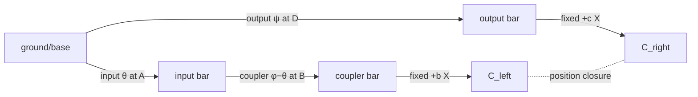

# Planar four-bar solver core

Date: 2026-11-13. This note records the implemented pure kinematic core in `frontend/planning/four-bar.js` and its focused test in `tests/four-bar.test.cjs`. It follows `notes/2026-11-13_closed_loop_design.md`. The mechanism has one independent input and no simulated constraint forces or contact dynamics.

## Supported cut-tree geometry

The descriptor names the input, coupler, and output revolute joints and the two distinct fixed endpoint links. The URDF snapshot must have this topology:

All three revolute axes must be +Z. Relevant origin matrices must be XY translations with identity rotation and scale. `input` is at local $(0,0)$; `output` is at $(d,0)$; the coupler, left pin, and right pin origins are $(a,0)$, $(b,0)$, and $(c,0)$ in their respective parent frames. The core derives $a,b,c,d$ from those matrices, rejects nonpositive dimensions, rejects extra movable joints, and validates finite joint limits. A rigid base mount is passed separately as `worldFromBase`, so the same local planar mechanism can be moved and rotated in the workcell.

## State and equations

The independent state is $u=[\theta]$. The expanded URDF state is

\[
q=[\theta,\;\phi-\theta,\;\psi].
\]

For a selected branch $\sigma\in\{-1,+1\}$, the circle intersection computes $C$ from $B=a e(\theta)$ and $D=(d,0)$, where $e(t)=(\cos t,\sin t)$. The solver checks the triangle inequality, separation of the circle centers, and height from the center line. It rejects intersection height $k\le10^{-6}$ m as a toggle. It then chooses $2\pi$ equivalents of the relative coupler and output angles within their URDF limits, nearest the supplied seed or initial state. It computes the **independent** cut-tree endpoints $C_\mathrm{left}=B+b e(\phi)$ and $C_\mathrm{right}=D+c e(\psi)$, and returns their distance as `closureResidual`.

With $E(x,y)=(-y,x)$, the passive derivatives with respect to input are obtained from

\[
\begin{bmatrix}b E e(\phi)&-c E e(\psi)\end{bmatrix}
\begin{bmatrix}\phi'\\\psi'\end{bmatrix}=-a E e(\theta),
\]

\[
\begin{bmatrix}b E e(\phi)&-c E e(\psi)\end{bmatrix}
\begin{bmatrix}\phi''\\\psi''\end{bmatrix}
=a e(\theta)+b e(\phi)(\phi')^2-c e(\psi)(\psi')^2.
\]

The module exposes `ratePerTheta=[1,φ′−1,ψ′]` and `secondPerTheta2=[0,φ″,ψ″]`. `fourBarRates` applies the chain rule to produce expanded velocity and acceleration for a timed input. The caller must use those values to enforce passive limits at **every timed sample**, not just path endpoints.

## Full-pose IK and API

- `createFourBarModel({descriptor,joints,worldFromBase,tipLink})` returns plain, Worker-clonable model data. `model.initial` has one input value; `model.expandedInitial` has three URDF values.
- `expandFourBar(model,theta,{seed})` returns the expanded values, pin locations, closure residual, and analytic derivatives, or a typed `joint_limit`, `unreachable`, `toggle`, or `closure` failure.
- `fourBarPose(model,theta)` returns world TCP position and quaternion at either named closure endpoint. The endpoint orientation follows its own bar, so the two cut endpoints coincide in position but generally differ in orientation, as a pin joint permits.
- `solveFourBarPose(model,target,options)` searches the bounded input interval and refines scalar residual minima. It accepts only if both position and orientation tolerances hold. `isStateValid([theta], candidate)` can reject collision states; its primary argument is the independent one-element vector. A success returns `q:[theta]` plus `expandedQ`.

The solver is deterministic and contains no browser or DOM access. The sampled IK search can miss a very narrow feasible interval between grid points; the current fixture's driver range is well away from its toggles. The supported frame convention is intentionally narrow; rotated link origins, signed axes, spatial linkages, and general closed-chain constraints require a separate model.

## Verification

`node --test tests/four-bar.test.cjs` passes 5 tests: descriptor/topology/geometry validation and Worker cloning; closure on both branches across 86 input samples; relative-angle identity; first and second derivative agreement with centered differences; typed limit, impossible-geometry and toggle failures; full-pose IK recovery, off-manifold rejection, and collision callback rejection. This is core-unit evidence. Browser playback, collision integration, and project ZIP restoration are owned by the integration work.
