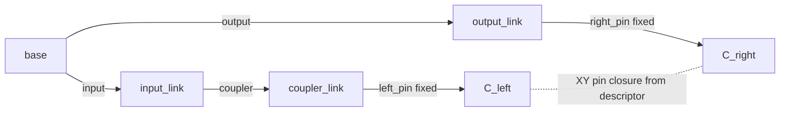
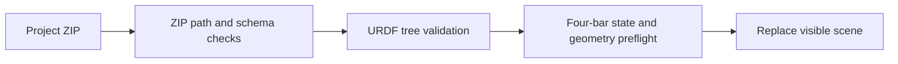

# Portable planar four-bar project extension

Date: 2026-11-13. This note records the portable source and preflight part of the first closed-loop mechanism implementation. The kinematic algorithm and playback contract are in `notes/2026-11-13_closed_loop_design.md` and `frontend/planning/four-bar.js`.

## Source shape

`testowe/four_bar/robot.urdf` is a valid cut-tree URDF. The only moving joints are `input`, `coupler`, and `output`; the closure links are separate fixed children `C_left` and `C_right`. URDF itself has no graph cycle. The companion `testowe/four_bar/kinematic-constraints.json` declares one version 1 `planar-four-bar` mechanism and assembly branch +1. The numerical lengths live only in the URDF joint origins, not in the descriptor.

The URDF origins give $A=(0,0)$, $D=(0.55,0)$ m, and $a=0.22$, $b=0.48$, $c=0.32$ m. All three revolute axes are +Z. Visual and collision boxes on the base and each bar are separated into Z layers; their joint frames remain at Z=0. The endpoint links have no visual geometry, so the coincident pin does not produce a spurious collision pair. A rendered collision check still needs to evaluate the full expanded pose at the actual world frames, including any robot base mount.

`testowe/four_bar/robot-state.json` saves **only** `input=0.6` rad. `testowe/four_bar/program.robot` selects `C_left` as TCP and gives three `MOVEJ` targets with only the independent input coordinate. The passive coupler and output values are calculated from the selected branch. The saved state produces approximately `coupler=-0.19934845934` rad and `output=1.33884312931` rad, with cut-tip position mismatch below $10^{-12}$ m in the focused browser preflight.

## ZIP contract and validation

`packProject` accepts optional `kinematicConstraints`; a ZIP then has `project.json` key `kinematicConstraints: "kinematic-constraints.json"`. `unpackProject` returns the normalized descriptor or `null` for older archives. The workcell ZIP format remains version 1; the extension has its own format and version. The descriptor is local to this app and is not a standard URDF or SDFormat constraint declaration.

`normalizeKinematicConstraints` accepts exactly one version 1 planar-four-bar mechanism, valid distinct named joints/tips, and branch ±1. ZIP unpack rejects malformed JSON, wrong descriptor format/version/field set, invalid file path, or a robot name not in the archive. `validateFourBarProjectState({descriptor,robotDocument,robotState})` then checks the URDF name and driver-only saved state, adapts the DOM joints to planner snapshots, calls `createFourBarModel`, and rejects an invalid saved input via `expandFourBar`. The workcell calls this before changing visible scene state. The solver validates the topology, coplanar axes and origins, lengths, joint limits, toggle condition, and home closure. Preflight checks 257 input values over the declared interval; planning checks every requested path sample. The interval check is sampled, not a mathematical certificate of every angle. A saved input outside its limits is rejected rather than silently replaced by the solver's fallback home search.

## Evidence and limits

- `node --test tests/project-bundle.test.cjs`: 6/6; descriptor, branch and driver-only state round trip, legacy archive works, malformed entries reject.
- `node --test tests/four-bar-project.test.cjs`: 1/1; Chromium DOM preflight derives the fixture dimensions, checks closed home state, and rejects a passive saved coordinate, wrong branch, out-of-plane pin, and incompatible passive limit.
- `node --test tests/four-bar-browser.test.cjs`: 1/1. Chromium opens `notes/artifacts/four_bar_fixture.workcell.zip`, plans 251 independent-coordinate samples over 4.159997 s, checks the actual world positions of both tip links at home, a time strictly between samples, finish, reset, manual input, and ZIP reopen. Maximum observed mismatch is $2.49\times10^{-16}$ m. Passive sliders are disabled; moving the input slider invalidates the stale plan. The export and reopen retain branch +1, input=0.7 rad, and program text. A corrupt URDF pin-origin archive is rejected by preflight with no change to the visible robot, tip positions, branch, or program. Numeric trace is `notes/artifacts/four_bar_browser.json`; inspected top-view screenshot is `notes/artifacts/four_bar_midpoint.png`; the round-trip archive is `notes/artifacts/four_bar_exported.zip`.
- The browser result is a sampled kinematic and UI check. It does not claim continuous collision freedom, dynamics, or constraint-force simulation.
