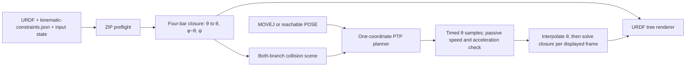

# Planar four-bar implementation review

Date: 2026-11-13. Review scope: the first, one-input planar four-bar in `modelrobot_internal`. This is a kinematic simulation of one assembly branch. It is not a general closed-loop dynamics or contact solver.

## Code path reviewed

The descriptor and driver-only state are parsed in `frontend/project-bundle.js` and prevalidated against the URDF in `frontend/kinematic-constraints.js` before `frontend/workcell-ui.js` replaces the scene. The cut-tree geometry in `testowe/four_bar/robot.urdf` gives $a=0.22$, $b=0.48$, $c=0.32$, and $d=0.55$ m from joint origins, with $θ$ in $[0.35,1.20]$ rad. The descriptor fixes branch $+1$. Its two distinct endpoint links, `C_left` and `C_right`, represent the same physical pin without adding a cycle to the URDF tree.

In `frontend/planning/four-bar.js`, the independent state is $u=[θ]$, while the tree state is $q=[θ,φ-θ,ψ]$. The circle intersection and both derivative signs agree with $a e(θ)+b e(φ)-d e_x-c e(ψ)=0$. The code enforces the selected branch, passive position limits, circle reachability, and a toggle threshold on each expansion. `ratePerTheta` and `secondPerTheta2` map input speed and acceleration to all three URDF joint rates. The code assumes +Z revolute axes and positive +X bar origins in the robot **base** frame; a world-frame robot mount may rotate and translate the whole linkage.

`frontend/four-bar-plan.js` plans PTP in $u$, computes both cut-tree arms for collision queries, limits angular movement of every expanded joint to 0.02 rad per collision edge sample, and scales the resulting duration using all three joints' sampled speed and acceleration limits. Its collision setup exempts precisely the `C_left`/`C_right` closure pair from self-collision; other robot and scene pairs remain checked. `frontend/planning/snapshot.js` carries the descriptor into the Worker. The ROS-shaped trajectory names only `input`; `expandedTrace` records the passive state for inspection. `ProgramPlayer` interpolates only $u$, and `workcell-ui.js` recomputes all three joint values on every seek, event, step, and play frame. This avoids opening the loop between timed samples. Manual input drives only `input`; passive sliders are disabled and pose dragging is blocked for this mechanism. GRAB/RELEASE remain available. The constrained planner reports typed failures for LIN/CIRC, welding, and positive ZONE rather than attempting paths outside this one-dimensional mechanism.

## Independent checks and browser evidence

- I recomputed the fixture branch at $θ=0.35,0.60,1.20$ rad. The coupler's **relative** URDF angles are approximately $0.163,-0.199,-0.958$ rad; output angles are $1.335,1.339,1.584$ rad. Each is inside its URDF limit. The separate Z layers of the bar collision boxes avoid a false pin collision in this fixture; the empty endpoint links have no collision shape.
- `tests/four-bar.test.cjs` checks branch closure, cut-tree geometry, passive joint limits, toggles, derivatives against centered differences, and pose IK. `tests/four-bar-plan.test.cjs` checks direct and Worker planning, input-only trajectory, every timed sample's closure, off-manifold pose rejection, passive-command rejection, and a restrictive passive velocity/acceleration override. The project test checks invalid descriptors before scene replacement. The final full test run in `notes/artifacts/test_full_four_bar_final.log` reports **206 passed, 0 failed**, including the browser round trip.
- The Chromium script `notes/scripts/check_four_bar_browser.cjs` measures the **actual rendered world positions** of `C_left` and `C_right`. `notes/artifacts/four_bar_browser.json` records closure at the saved state, a time strictly between planner samples, finish, reset, manual input, and after ZIP import. The largest measured endpoint separation is $2.49\times10^{-16}$ m; the plan has 251 samples over 4.16 s and the page logged no errors. `notes/artifacts/four_bar_midpoint.png` shows the linkage in top view with the input, coupler, and output bars visually meeting. I inspected the screenshot.
- I independently inspected `notes/artifacts/four_bar_exported.zip`: the manifest points to `kinematic-constraints.json`, the saved branch is $+1$, and `robot-state.json` contains only `input=0.7`. The program is present. The browser script waits for the explicit `Opened project four_bar_lesson.` status before asserting the reopened state. It also imports a deliberately malformed pin origin and verifies that rejection leaves the prior closed robot, branch, and program unchanged. The updated browser test passes.

## Limits and follow-up

1. Geometry and collision are sampled. The 257-point descriptor preflight, planner collision sweep, and timed speed/acceleration checks do not prove a continuous interval guarantee. Near a toggle, curvature or a very thin obstacle can still require finer checking.
2. Only the two declared endpoint links are exempt from self-collision at the closure pin. Collisions between their parent bars are still checked. Authors need separated bar collision solids around intentional hinge contact, as in the supplied fixture. The new planner unit fixture adds coincident endpoint spheres to verify the exact endpoint-pair exemption.
3. LIN/CIRC and positive ZONE are rejected for this mechanism even if a specially chosen TCP path could lie on the one-dimensional manifold. The current implementation supplies PTP and endpoint pose IK, not constrained Cartesian path following. A rendered closure-error indicator from the design note is also not present; the browser trace and solver checks are the existing diagnostics.

Notation: $θ,φ,ψ$ are absolute planar angles in radians; the coupler URDF joint stores $φ-θ$. All pin points are measured in metres, and the browser residual is the world-frame Euclidean distance between endpoint origins. This note reviewed code and visible browser evidence; it does not assert physical forces, friction, or dynamics.
