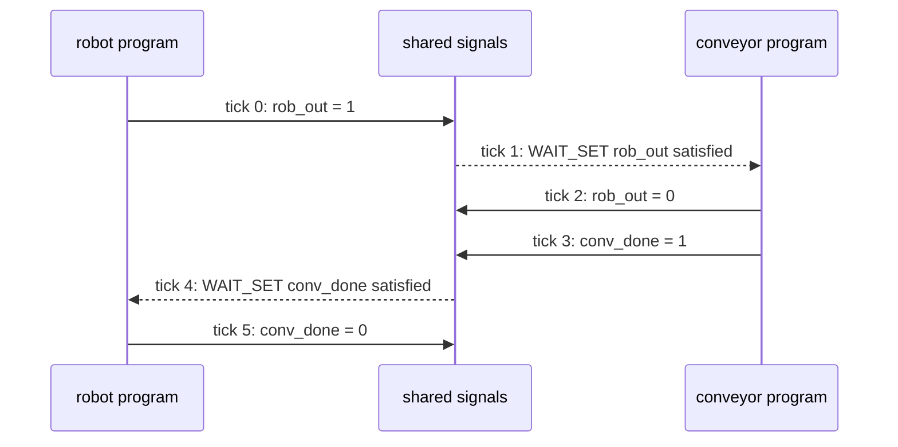

# Multi-program signal language (2026-11-13)

`frontend/multi-program-language.js` compiles a deliberately small text language into the typed input of `frontend/multi-program-scheduler.js`. This is a browser-side design choice for the new workcell, not a claim about EASY-ROB syntax or its scheduler order. The EASY-ROB device communication investigation is recorded in `/media/duzy/robot_easy/notes/2026-11-13_easy_rob_device_communication.md`.

## Grammar and API

```text
source      ::= (blank | comment | program)*
program     ::= "PROGRAM" name newline statement* "END"
statement   ::= "SET" name number
              | "WAIT_SET" name ["TIMEOUT" ticks]
              | "WAIT_UNSET" name ["TIMEOUT" ticks]
              | "WAIT_VALUE" name comparator number ["TIMEOUT" ticks]
comparator  ::= "==" | "!=" | "<" | "<=" | ">" | ">="
name        ::= [A-Za-z_][A-Za-z0-9_.:-]*
number      ::= signed finite decimal, optionally with e/E exponent
ticks       ::= positive safe decimal integer (logical scheduler ticks)
comment     ::= "#" through end of line
```

Keywords are uppercase and case sensitive. Whitespace separates tokens. `TIMEOUT` has no wall-clock unit: a wait that remains false for `n` scheduler steps times out on the `n`th step. There are no variables, string literals, arithmetic expressions, function calls, imports, loops, or eval. Numeric signals absent from the initial signal map read as zero. `WAIT_SET` tests `value > 0.5`; `WAIT_UNSET` tests `value <= 0.5`. `WAIT_VALUE` uses an exact numeric comparison. These are scheduler definitions, not PLC electrical semantics.

`compileMultiProgram(source)` returns `{ programs, diagnostics, ok }`. Each program is `{name, commands}` and each command has `kind`, `signal`, its arguments, and a one-based `line`. Diagnostics have `{line, column: 1, code, message}`; only line precision is promised. Caller must require `ok === true` before passing `programs` to `createMultiProgramState({programs, signals})`. Valid commands from malformed sources may still appear in `programs` for inspection, so `ok` is the gate.

| Text | Scheduler command |
| --- | --- |
| `SET s 1` | `SET_SIGNAL`, `signal: 's'`, `value: 1` |
| `WAIT_SET s TIMEOUT 12` | `WAIT_SIGNAL_SET`, `timeoutTicks: 12` |
| `WAIT_UNSET s` | `WAIT_SIGNAL_UNSET` |
| `WAIT_VALUE s >= 3` | `WAIT_SIGNAL_VALUE`, `operator: '>='`, `value: 3` |

The bundled fixture is [`testowe/multi_program/handshake.mprg`](../testowe/multi_program/handshake.mprg). With `rob_out=0` and `conv_done=0` initially, the robot sets its request, the conveyor observes it on the next tick, clears the request, raises completion, and the robot clears completion. It finishes after six logical ticks. Programs are sorted by name on each tick, waits read a start-of-tick signal snapshot, and writes commit at the end. Same-tick writes to one signal fail atomically. These rules are in the pure scheduler and make the trace independent of the fixture's block order.



The fixture is **signal only**. A later adapter must translate a robot motion or device action into a timed, independently advancing activity and define how it starts, completes, fails, and emits signals. This parser neither drives a robot nor simulates conveyor dynamics or real I/O. UI and project ZIP integration are separate work.

## Verification

`node --test tests/multi-program-language.test.cjs tests/multi-program-scheduler.test.cjs` covers compilation, source locations, malformed input, finite-number and timeout validation, all four command families, the bundled handshake, and the scheduler's deadlock/conflict/timeout behavior.
