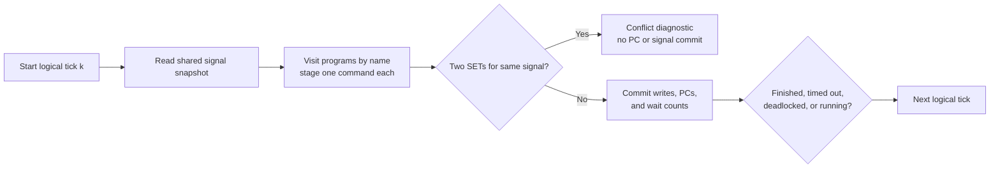

# Deterministic multi-program signal scheduler

Date: 2026-11-13. This is a browser-side foundation for later multi-device programs, implemented as the pure module [`frontend/multi-program-scheduler.js`](../frontend/multi-program-scheduler.js). It has no UI integration and does not run robot or device motion. The behavioral reference is the archived [EASY-ROB device communication investigation](../../notes/2026-11-13_easy_rob_device_communication.md): separate device programs retain their own line positions, share numeric values, and use set/wait/clear handshakes. That investigation explicitly did **not** recover EASY-ROB's same-tick iteration order. The rules below are a new, documented choice for this browser application, not a claim that EASY-ROB schedules identically.

## Typed commands and API

`createMultiProgramState({programs,signals})` produces a serializable plain state. Each program is `{name,commands}`; the scheduler stores a separate program counter (`pc`), wait count, and status. Initial signals are finite numeric values; a signal absent from the map reads as zero. The accepted command objects are:

| Command | Fields | Meaning |
|---|---|---|
| `SET_SIGNAL` | `signal`, finite `value` | Assign a shared numeric signal at tick commit. |
| `WAIT_SIGNAL_SET` | `signal`, optional `timeoutTicks` | Advance when the tick-start value is greater than 0.5. |
| `WAIT_SIGNAL_UNSET` | `signal`, optional `timeoutTicks` | Advance when the tick-start value is at most 0.5. |
| `WAIT_SIGNAL_VALUE` | `signal`, `operator`, finite `value`, optional `timeoutTicks` | Compare using `==`, `!=`, `<`, `<=`, `>`, or `>=`. Equality is exact. |

An optional positive integer `line` is retained in trace events. `timeoutTicks` is a positive count of **logical scheduler ticks**, not seconds. `stepMultiProgram(state)` returns `{state,events,diagnostics}` without mutating the input. `runMultiProgram(state,{maxTicks})` repeatedly steps and returns `{state,trace,diagnostics}`. `maxTicks` is also a logical-tick bound; it defaults to 1000.

## Tick rule

Program names are sorted by JavaScript code-point order, independent of their input listing order. In each tick, every unfinished program evaluates at most one command. All waits read the signals at the **start** of that tick. SET commands stage writes, then commit after all programs have been visited. A SET in tick *k* can therefore first satisfy another program's WAIT in tick *k+1*. If two programs stage a write to the same signal in one tick, the tick fails atomically with `SIGNAL_WRITE_CONFLICT`: neither value nor either program counter changes. The attempted tick count still advances. This makes the outcome independent of load order and avoids an implicit last-writer-wins race.

For a robot/conveyor-style handshake, `robot` sets `rob_out=1`, `conveyor` waits for it and acknowledges by clearing it, then sets `conv_done=1` for the robot to observe:

| Tick | Conveyor command | Robot command | Committed result |
|---:|---|---|---|
| 0 | WAIT `rob_out`: blocked | SET `rob_out=1` | `rob_out=1` |
| 1 | WAIT `rob_out`: satisfied | WAIT `conv_done`: blocked | No write |
| 2 | SET `rob_out=0` | WAIT `conv_done`: blocked | `rob_out=0` |
| 3 | SET `conv_done=1` | WAIT `conv_done`: blocked | `conv_done=1` |
| 4 | Finished | WAIT `conv_done`: satisfied | No write |
| 5 | Finished | SET `conv_done=0` | Both programs finished |

An unmet WAIT keeps its PC and increments its wait count. When its count reaches `timeoutTicks`, the run ends with `WAIT_TIMEOUT` and a program/PC/signal/tick diagnostic. If every unfinished program is blocked on an untimed WAIT, and no program can SET a signal, the run ends with `DEADLOCK`. When timed and untimed waits coexist, the scheduler allows the timed wait to reach its deadline and reports its timeout. A caller can bound any run with `maxTicks`; exceeding it yields `RUN_LIMIT`.

## Adapter boundary and current limits

The scheduler only advances signal commands. It does not execute ERPL, parse free-form conditions, control a robot, or represent a motion duration. A later program/device adapter should compile source lines into these typed signal commands, supply each device's preplanned motion segments with explicit start/completion ticks, and hold that program's PC while its segment is active. That integration will need an explicit external-write/in-flight-work extension so a program waiting for a future device completion is not mistaken for a closed-system deadlock. The choice of tick duration in simulation seconds belongs to that adapter; this core deliberately uses integer logical ticks so tests are independent of wall-clock timing.

`tests/multi-program-scheduler.test.cjs` verifies a successful handshake, load-order independence, next-tick signal visibility, numeric waits, atomic conflicting writes, deadlock, timeout, input validation, and bounded runs. The state and trace contain plain data and can be cloned for deterministic replay.
