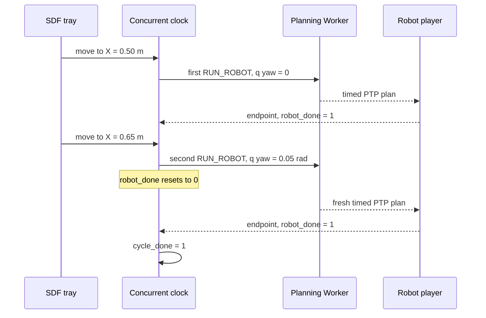

# Two command-time robot runs in the browser — 2026-11-13

The Program panel now offers **Load two-run example**. It loads the existing six-axis URDF and conveyor SDF, `testowe/multi_program/two_requests.robot`, and `testowe/multi_program/two_requests.mprg`. One concurrent program moves the tray to X = 0.50 m, runs the robot movement source, waits for read-only `robot_done`, moves the tray to X = 0.65 m, runs the same source again, waits for its new completion, and sets `cycle_done`. `RUN_ROBOT` remains a command-time Worker plan from the current robot joints and SDF poses. The triggered UI uses a fresh `ProgramPlayer` for each accepted plan and keeps the whole-cycle Reset baseline. The status line shows the robot run count.

Chromium test `tests/two-request-browser.test.cjs` executes the UI example button and intercepts both real Worker requests. The first snapshot sees tray X = **0.50 m**, base yaw **0 rad**. The second sees tray X = **0.65 m**, base yaw **0.05 rad**, proving the second plan uses the scene and joints after the first plan and intervening device move. At tick 19 the second run starts with `robot_done = 0`; a later sample verifies yaw below **−0.02 rad** during its movement, and at tick 34 both `robot_done` and `cycle_done` equal 1. It verifies the second `ProgramPlayer` is a new object with a postdevice scene baseline. Reset restores tray X = **0.20 m** and yaw **0 rad**. No page errors occurred. Numeric evidence is in [two_request_browser.json](artifacts/two_request_browser.json); rendered evidence is in [between](artifacts/two_request_between.png), [second plan](artifacts/two_request_second_plan.png), [second motion](artifacts/two_request_second_motion.png), and [finished](artifacts/two_request_finished.png) screenshots. Focused clock plus browser tests pass **15/15** after `npm run build`.

The movement source is fixed for a triggered cycle and replanned at each request; users may edit it before preparing a new cycle. `robot_done` is a level signal: a different concurrent program waiting on it can read the prior run's `1` on the same tick that another program requests a new run. Use an explicit user signal to coordinate across programs; a `WAIT_SET robot_done` after `RUN_ROBOT` in the same program sees the reset value. A robot request during an active trajectory fails atomically with its source line. Device motion during a robot trajectory remains prohibited. Device motion is kinematic and has no swept collision or acceleration check; simultaneous moving-body planning and physical I/O remain open. Core semantics and failure cases are in [the clock note](2026-11-13_multi_request_clock.md).
