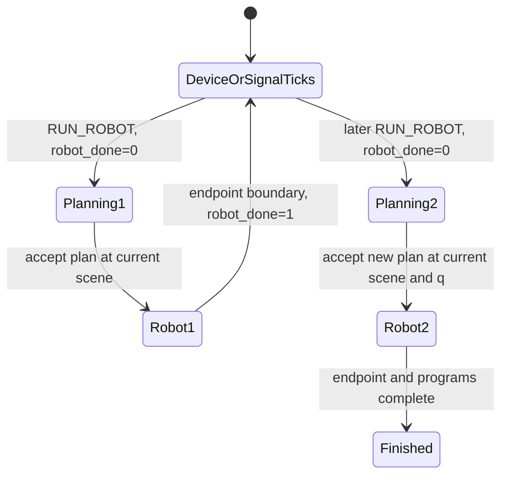

# Sequential `RUN_ROBOT` clock core — 2026-11-13

`frontend/triggered-clock.js` now accepts one or more typed `RUN_ROBOT` commands in a triggered run. Its exported API is unchanged. Each request still commits at a logical tick end, freezes simulation time while the browser Worker plans from the current scene and joints, and resumes after `acceptRobotPlan`. The state adds `requestCount` so the UI can identify successive plans; the returned request object remains `{program,line,tick,timeSeconds}`.

```text
PROGRAM arm
RUN_ROBOT
WAIT_SET robot_done TIMEOUT 80
SET device_start 1
WAIT_SET device_finished TIMEOUT 80
RUN_ROBOT
WAIT_SET robot_done TIMEOUT 80
END
```

The first `RUN_ROBOT` sets read-only `robot_done` to zero. It becomes one at the first tick boundary on or after that trajectory ends. A later `RUN_ROBOT` is allowed after the prior trajectory has finished; its request tick resets `robot_done` to zero and freezes at a new planning boundary. The next accepted plan's first joint vector must match the current endpoint within $10^{-6}$ in the same joint order. A request whose tick overlaps an active trajectory fails atomically with `ROBOT_BUSY` and the request's source line. Two requests in the same tick remain an atomic scheduler conflict. Device motion while a robot trajectory is active still fails before that tick commits.



`robot_done` is a level signal for the most recently requested trajectory. A program that waits for a specific later request should reach its `WAIT_SET robot_done` **after** that request (as in the example); another program can use a user signal to coordinate which request has started. At plan acceptance, the core retains unsynchronized models touched by earlier robot GRAB/RELEASE/WELD_JOIN events. The UI must apply the completed robot player's scene events and call `syncTriggeredDevices` before any later device command for those models. The new plan replaces the previous samples while preserving the current joint endpoint.

`tests/triggered-clock.test.cjs` now covers two requests separated by a device move, the second request's reset of `robot_done`, q continuity and interpolation, busy and same-tick conflicts with source lines, planning failure and fresh-run reset, and the earlier overlap/device-origin checks. Focused run: **14/14 passed**. Browser Worker replanning and visual evidence are owned by the parent integration task.
