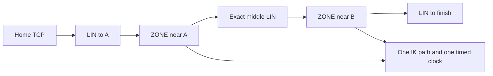

# Chromium proof: two consecutive Cartesian flybys

The reproducible input is `testowe/zone_multicorner/program.robot`, loaded with the visible three-axis gantry `testowe/zone_orientation/robot.urdf` and `testowe/weld/world.sdf`. Run `node --test tests/multicorner-zone-browser.test.cjs`. The Playwright script is `notes/scripts/check_multicorner_zone_browser.cjs`; its full numeric trace is `notes/artifacts/multicorner_browser.json`. I inspected `notes/artifacts/multicorner_stopped.png` and `notes/artifacts/multicorner_blended.png` in the rendered top-view workcell. The screenshots show the gantry and workpiece; the saved numeric trace distinguishes the subtle corner positions and velocities.

The program commands three consecutive `MOVEL` targets with TCP yaw 0.4, 0.8, and 1.2 radians. For the control run, replacing `ZONE 0.06` with `ZONE 0` makes the first two commanded corners exact stops. With the positive zone, the same program has two flybys planned as one trajectory.

| Case | Corner 1 time / yaw / joint speed norm | Corner 2 time / yaw / joint speed norm |
|---|---|---|
| `ZONE 0` | 1.449941 s / 0.399835 rad / 0 | 2.400462 s / 0.799640 rad / 0 |
| `ZONE 0.06` | 2.834214 s / 0.417075 rad / 0.484749 | 3.472888 s / 0.787923 rad / 0.502877 |

The player was sought to each timed boundary and the browser joint collection agreed with its planned sample to numerical precision. Each flyby stayed within 0.045003 m of its nominal waypoint, below the requested 0.06 m radius. The declared angular speed bound was 0.638018 rad/s, below the 1 rad/s default. ROS-shaped trajectory timestamps were strictly increasing; Chromium reported no page errors. The positive-zone run took 5.877585 s, longer than the stopped run because it was retimed for limits and geometric tracking. This example demonstrates continuation through both corners; it is not a continuous collision certificate.

