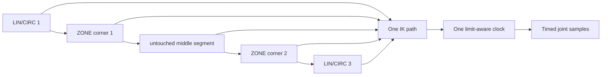

# Consecutive Cartesian ZONE run

## Code path

`planProgram` in `frontend/program-plan.js` collects a maximal run of three or more consecutive `MOVEL`/`MOVEC` commands for which the sticky `ZONE` radius on both sides of each boundary is positive. A `ZONE 0`, non-Cartesian command, or process command ends the run. The existing two-command `planCartesianZonePair` branch remains intact.

The run is sent to `planCartesianZoneChain` in `frontend/planning/cartesian-zone.js`. Each nominal segment is an exact `linearPath` or `circularPath`. A corner is constructed by the existing `createCartesianZonePath`: it trims portions of the neighboring segments, inserts a quintic positional Bézier transition and an SO(3) orientation transition, and preserves CIRC via poses outside its trims. The chain verifies that adjacent trims on a middle segment do not overlap. The current individual trim cap of one third of its segment length also leaves middle-segment space, but the explicit check protects future changes.

Let segment lengths be \(L_i\), cumulative offsets \(S_i=\sum_{j<i}L_j\), and corner \(i\) have inbound/outbound trims \(d_i^-,d_i^+\). Its global transition interval is

\[
[S_{i+1}-d_i^-,\; S_{i+1}+d_i^+].
\]

Outside the transition intervals, the composite TCP reference calls the original LIN/CIRC path. Inside, it calls the corresponding local corner path with the global distance mapped into that pair. Every corner entry, logical boundary, and exit, plus every CIRC via, is a required exact IK/timing sample. All corners share **one** `solveCartesianPath` call and **one** `timeParameterize(..., allowInternalStops: false)` call. The global quintic clock therefore has no inserted stop at a command or corner boundary. A conservative full-run angular speed bound uses the maximum local path/transition body angular rate; it retains the default 1 rad/s cap (or configured `cartesianZone.maxAngularSpeed`).

`planProgram` emits one logical `plans` record per source motion and one `cartesianZoneBlends` record per corner. The exact timed corner samples define adjacent plan end/start times. A failed geometric or timed sample reports the nearest corner index, and a later-corner program diagnostic uses its arriving command line. The application still validates collision, joint limits, FK-to-TCP residual, nonzero corner speed, waypoint radius, and angular speed. These are sampled checks except for the control-hull position bound and angular-rate bound from the declared geometric reference.

## Verification

`node --test tests/program-cartesian-zone.test.cjs tests/planning-cartesian-zone.test.cjs` passed 25/25. New checks cover three changing-yaw LIN moves, two disjoint transitions, nonzero speed at each timed boundary, exact middle CIRC via, Worker parity, `ZONE 0` as a break, a four-move run, changing sticky radii, strictly increasing trajectory time, a collision attributed to the second corner, and a feasible flyby around a colliding nominal middle waypoint. Browser verification is tracked separately.

## Limits

The nominal target resolution uses collision-independent endpoint IK only when the following command refers to a non-world frame that may need the expected robot configuration. World-frame targets skip that preliminary IK, so the final flyby can bypass even an unreachable or occupied nominal waypoint. Collision and edge checks run on the final composite path. No process action is allowed inside a flyby run; commands such as `GRAB` end it. The trajectory is a position-controlled plan with joint velocity/acceleration limits, not a dynamic contact simulation.
