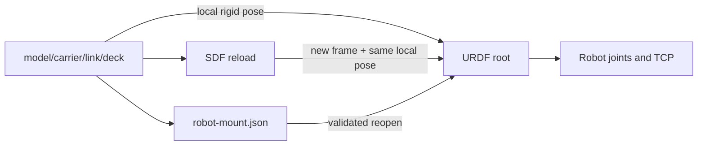

# Robot base mount and project persistence

`SceneModel` now owns an explicit URDF-root-to-SDF-frame mount. `mountRobotBase(robotName, frameName, { keepWorldPose = true, localPose = null })` accepts a `model/<name>` or `model/<name>/link/<link>` frame. With no `localPose`, it preserves the robot root's current world transform and stores the resulting rigid local pose. With `localPose`, it positions the root at that offset; quaternion values are normalized. `frameName='world'` unmounts while preserving the current world transform. `unmountRobotBase(robotName)` and `robotMountRecord(robotName?)` expose the inverse action and a cloned `{robot,frame,localPose:{position,quaternion}}` record. Multiple simultaneous robot mounts require a name when reading a record without ambiguity.

Mounting rejects unknown frames, nonunit-scale transforms, zero quaternions, and scene graph cycles. A model already attached beneath the robot cannot become its carrier; a carrier below the robot cannot later be attached to one of that robot's links. A mount is configuration for a serial URDF root under a scene frame, not an additional URDF joint.

`loadWorld()` checks that every mounted frame exists in the replacement SDF **before** altering the old scene. It detaches mounted URDF roots to the world, rebuilds the SDF layer, and reapplies each saved local pose to the replacement frame. An unrelated SDF world needs an explicit unmount first. `clear()` drops mounts; `removeRobot()` unmounts before deleting robot frames. This prevents the URDF root from being left under a destroyed carrier group during reset or reload.

Portable ZIP archives can contain an optional `robot-mount.json` named in `project.json`. `packProject({robotMount})` validates that the record names an archived robot, contains an SDF model frame and finite pose, and normalizes its quaternion. `unpackProject()` returns `robotMount` or `null` for older ZIPs. It rejects malformed JSON, a zero quaternion, or a mount naming an unavailable robot. The Workcell integration must still validate the frame against the parsed SDF before replacing the current project, then restore the mount after loading the SDF and URDF.

Focused `node --test tests/scene-model.test.cjs tests/project-bundle.test.cjs tests/robot-mount.test.cjs tests/device-swept-collision.test.cjs` passed 19/19. The new mount tests cover world-pose preservation, carriage with a moved model, SDF replacement, atomic missing-frame failure, cycle and scale rejection, robot removal, optional ZIP round trip, and older ZIP compatibility.

