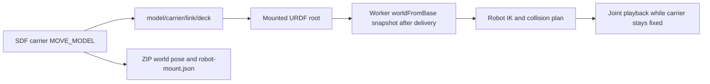

# Review: independently programmed SDF carrier and URDF base mount

Date: 2026-11-13. This is a read-only review of the robot base mount implementation, Worker planning snapshot, project ZIP metadata, and browser example. I ran `node --test tests/robot-mount.test.cjs tests/external-carrier-browser.test.cjs tests/device-swept-collision.test.cjs tests/project-bundle.test.cjs` (17/17 passed). After the declared mount-contact and planner-cycle fixes, `node --test tests/robot-mount.test.cjs tests/planning-collision.test.cjs tests/planning-worker.test.cjs tests/external-carrier-browser.test.cjs` passed **16/16**. The earlier full suite log `notes/artifacts/test_full_t27.log` reports 186/186 before the later amendments; a fresh full-suite run belongs to final integration verification. `git diff --check` was clean.

The Chromium trace `notes/artifacts/external_carrier_browser.json` and screenshots `external_carrier_mid.png` and `external_carrier_robot_done.png` were inspected. The independently programmed SDF carrier moves to X=0.1 m, carrying the robot base by the same amount. At X=0.2 m, `RUN_ROBOT` freezes and plans from `worldFromBase[12]=0.2`; the robot then reaches its commanded joints/TCP. Reset returns the original carrier/base position, and project ZIP reopen restores mount metadata, carrier pose, and joints.

## Confirmed lifecycle behavior

- `SceneModel.mountRobotBase` stores a normalized local position/quaternion on an SDF model or model-link frame. It preserves the world pose on manual mount and requires rigid unit-scale frames. It rejects scene graph cycles. `clear` moves the robot root back to the scene before old SDF groups are discarded; `loadWorld` remounts it to a replacement frame using the stored local offset.
- The Workcell selector invalidates an old plan on mount change. `beforeRobotReparse` unmounts before CoffeeScript clears the old URDF root; `onRobotLoaded` reattaches the new root to the saved SDF frame. I independently exercised same-URDF reparse in Chromium: mount frame, local offset, and world base pose were unchanged. Reapplying the same SDF also retained the mount; replacing it with an SDF without the frame unmounted the robot to the world while keeping its world pose.
- The optional `robot-mount.json` project entry is shape-validated and normalized by `packProject`/`unpackProject`. `validateProjectAttachments` checks the mounted robot name, frame existence, and SDF attachment cycles before the UI mutates a project. Import restores world, URDF, independent joint values, mount, then object attachments. Older ZIPs omit the entry and remain readable.
- The device sweep sees robot collision shapes as descendants of the SDF carrier during its linear tick translation. The planner's new mount rule exempts carrier collision only against links rigidly fixed to the URDF base; moving links still collide. The contact fixture intentionally overlaps a carrier bracket with the fixed base and both direct planning and Worker browser route succeed.

## Preflight mismatch found and resolved during review

The current detached planning collision scene's `attach(object, frame, q)` initially treated the mounted carrier as an ordinary SDF object. A direct reproduction with a robot mounted under `model/carrier` produced `planned: accepted` for `attach('carrier','tool',q)`, while live `SceneModel.attach('carrier','robot/arm/link/tip')` threw `Attachment would create a scene graph cycle.` A movement program containing `GRAB carrier` could therefore preflight successfully and fail at playback. The same issue can affect an SDF ancestor of the carrier and a target model already attached under the robot.

The planner now mirrors live scene ancestry: it rejects attaching the mounted carrier or any SDF ancestor of it to a robot/tool frame or a model frame that is itself under the robot. `tests/planning-collision.test.cjs` exercises direct carrier→tool and ancestor→robot-held-model attempts, and confirms both planner and live `SceneModel.attach` reject the cycle. `planProgram` turns the thrown preflight error into a source-located diagnostic. The focused set passed after this fix; **no blocking review issue remains**.

## Remaining boundaries

This is a kinematic mount and scene-device translation, not simultaneous coordinated robot and carrier planning. The clock still rejects `MOVE_MODEL` while a robot trajectory is active. Device collision checks are sampled along each tick (5 mm default relative translation) and have a sample budget. The mount collision exemption covers the whole declared carrier model against fixed base links, so an unexpected fixed overlap is treated as internal mount geometry; moving links are checked.
