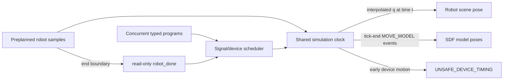

# Shared simulation-time core — 2026-11-13

`frontend/shared-clock.js` now advances a preplanned robot trajectory and the concurrent signal/device scheduler from one simulation-time coordinate. This is a pure state transition; the browser UI chooses when to call it and applies the returned robot joint vector and changed device poses. The existing `ProgramPlayer` is not modified.

## Contract

```js
const clock = createSharedClock({
  samples: plannedRobotSamples,
  robotEvents: plannedRobotEvents,
  schedulerState: createMultiProgramState({ programs, devices }),
  tickSeconds: 0.1,
});
const { state, events, diagnostics } = advanceSharedClockTo(clock, 0.35);
// Or stepSharedClock(clock) for the next logical-tick boundary.
```

`state.timeSeconds` is simulation time, `state.q` is the robot joint vector interpolated between planner samples, and `state.schedulerState.devices` contains committed world XYZ origins. Scheduler events gain `timeSeconds` equal to their tick-end time. `MOVE_MODEL` events identify the model to apply to the scene; other movable models in the scheduler snapshot must not be reapplied because the robot may have carried them. Calls are monotonic and do not mutate input state. The robot trajectory begins at time zero; scheduler tick `n` reads signals at `n·Δt` and commits at `(n+1)·Δt`.

`robot_done` is a reserved, read-only numeric signal. It begins at zero and becomes one at the first tick boundary on or after the robot plan ends (immediately for a zero-duration plan). The shared clock stays active until that boundary even if all scheduler programs finished earlier. For example, with a 0.25 s robot plan and 0.1 s ticks, `robot_done` is zero at 0.25 s and one at 0.30 s. An untimed `WAIT_SET robot_done` does not deadlock while the robot is still moving: the scheduler now accepts an optional `externalPendingSignals` list for this purpose. A timed wait still counts each tick and can time out.

The planner made its collision snapshot before playback. To keep that snapshot valid, any `MOVE_MODEL` that starts before the robot trajectory ends produces `UNSAFE_DEVICE_TIMING` with program and source line, without committing the unsafe tick. A model named by a robot GRAB, RELEASE, or WELD_JOIN event is rejected at clock creation because its captured device origin could become stale after robot handling. This conservative rule allows the robot to finish, then a signal-controlled device to move. It does not claim collision checking for simultaneous moving bodies or arbitrary command-time robot replanning.



`tests/shared-clock.test.cjs` verifies joint interpolation between samples, exact endpoint, `WAIT_SET robot_done` ordering around a nonaligned end time, the early-finished-program boundary case, early-device rejection without mutation, read-only signal protection, robot-handled model protection, and a zero-duration robot plan. The focused shared-clock plus scheduler tests pass 16/16. Browser integration and visual proof are the next layer of the task.
