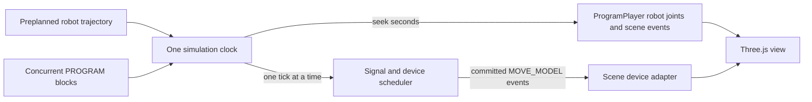

# Shared robot and device simulation clock — design review

Date: 2026-11-13. This note inspects `frontend/program-player.js`, `frontend/workcell-ui.js`, `frontend/multi-program-scheduler.js`, and the Worker planner. It separates a bounded first integration from the more general autonomous robot/device program path.

## Existing clock ownership

`ProgramPlayer` owns a `requestAnimationFrame` loop only inside `play()`. Its `seek(t)` is deterministic: it interpolates planned joints, applies GRAB/RELEASE/WELD_JOIN events in time order, and uses the scene snapshot captured at `load()` to restore on a backward seek. `reset()` and `restoreStart()` reload the **entire** SDF world. The concurrent-program scheduler has deterministic integer ticks, shared numeric signals, and `MOVE_MODEL` world-axis samples. Its UI currently steps or runs those ticks independently and applies every captured movable model pose.

The conservative next step is one owner of simulation time. Preplan the robot trajectory at the current scene pose, start it at t=0, then run device/signal programs at fixed positive `tickSeconds` (for example 0.1 s). The shared controller calls `player.seek(t)` and `stepMultiProgram()`; it never calls `player.play()`. One RAF advances the shared clock through every elapsed tick in order, while Pause freezes the logical clock and Step advances exactly one tick. Do not skip ticks after a delayed browser frame because signals and device events are discrete.

## First integration contract

At boundary `k`, time is `t_k = k Δ`, where `Δ = tickSeconds > 0`. Derive a **read-only** `robot_done` signal exactly when `t_k >= D`, where `D` is the plan duration, before the scheduler reads its tick-start signal snapshot. Take a tentative scheduler step and validate it before changing the scene. On an accepted tick, seek the robot to `min(t_k, D)` and apply committed signal/device state. Thus a `WAIT_SET robot_done` at program counter `pc` may complete on tick `ceil(D/Δ)`; its next command executes on the following tick. Reserve `robot_done` so source `SET robot_done ...` is rejected. With `D=0`, it is set at the initial boundary. The controller stops only after both the robot plan and all concurrent programs have finished, or on a typed scheduler/runtime error.

To preserve the static-scene collision guarantee of the preplanned robot path, reject a `MOVE_MODEL` event scheduled while `t_k < D` (including same-boundary starts whose motion interval overlaps the robot). The rejection must occur on a tentative step **before** changing either actor's scene state; report the program and source line. This permits signals to run alongside the robot and devices to move afterward. It is an intentional first restriction, not general moving-obstacle planning. Future device-first behavior requires planning the robot from the post-device scene at command start, and overlap requires collision checks against both moving actors.

`captureSceneDevices()` currently records all detached `static=false` SDF models, including objects that a robot trajectory may later GRAB. `applySceneDevices(sceneModel,state)` applies **every** entry and rejects attached models. The shared controller should apply only names that emitted a committed `MOVE_MODEL` event in that tick (with target validation), so an untouched object can be carried by GRAB. A command that tries to move an attached model must still fail explicitly. If the controller instead reuses the existing all-device adapter, any pick-and-place robot plan that attaches an initially movable workpiece will fail during synchronized playback.

Reset must stop RAF, restore one combined baseline (world SDF pose, attachments, robot q, initial signal/device state, counters, tick zero), and leave the robot player and scheduler consistent. Calling only `ProgramPlayer.reset()` can erase device movement; calling only scheduler reset can leave the robot at its endpoint. Normal robot playback and shared playback need exclusive controls so two RAF loops cannot fight over joints. Editing the SDF, URDF, motion source, or signal source invalidates the shared run and plan; exporting a ZIP stores the current scene pose and source, not execution time.

## General programmatic start and wait path

The bounded t=0 bridge does **not** let a signal start the robot or let a device move before the robot plan. For full programmatic sequencing, add typed `START_ROBOT` and `WAIT_ROBOT` (or a blocking `RUN_ROBOT`) to the concurrent DSL. At `START_ROBOT`, pause simulation time while a Worker plans the movement program against the **current** robot q and scene pose, then start `ProgramPlayer` at that boundary. A `WAIT_ROBOT` reads completion on a later tick; another program may observe a reserved completion signal. A second start while active should fail. Replanning cannot reuse `planCurrentProgram()` unchanged: it invalidates the previous plan and can reset an older scene snapshot. Use a separate “plan from current state” entry point or a fresh player per run. Any overlapping device motion needs checked moving-obstacle treatment; until then, reject it before commit.

## Verification gates

- Pure clock tests: exact and noninteger `D/Δ`, zero-duration plan, one-tick signal visibility, pause/resume without skipped or duplicated ticks, bounded catch-up, terminal error, and reset to the same baseline.
- Collision-integrity test: `MOVE_MODEL` during active robot motion yields a line-located error with unchanged joint/device state for the rejected tick; movement after `robot_done` succeeds.
- Interaction test: a robot GRAB of an initially movable SDF object succeeds while unrelated signal ticks run; the device adapter never reapplies that object's original pose while attached.
- Chromium visual probe: load a six-axis robot, SDF world, planned robot program, and concurrent device program; capture an intermediate robot pose, a post-robot device intermediate pose, final pose, Pause/Step/Reset, and no page errors. Record numeric time, q, and model positions beside screenshots.
- ZIP test: export at a completed or paused scene and reopen at those saved poses with program sources preserved, while execution counters restart at zero.

The t=0 bridge is meaningful progress toward T-10 but does not complete its general robot/device programming, LIN/CIRC blends, closed-loop kinematics, external axes, or multi-robot items.
