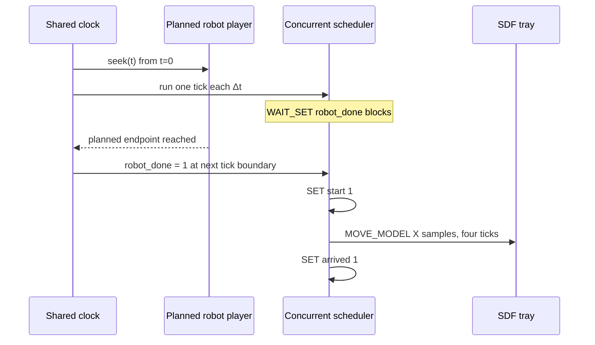

# Browser shared timed run — 2026-11-13

The Program tab has a **Shared timed run** section. A student plans the robot movement program first, then prepares the concurrent signal/device program with a positive seconds-per-tick value. `frontend/shared-clock.js` owns the deterministic simulation-time state. The browser owns one animation-frame loop for **Play together** and uses the same pure clock for **Step time**, **Pause**, and **Reset together**. `ProgramPlayer.seek(t)` applies the robot's already planned joint samples and GRAB/RELEASE/WELD_JOIN events; `ProgramPlayer.play()` is not used during a shared run. Only SDF models named by committed `MOVE_MODEL` events are applied from the device state, so untouched movable workpieces can still be robot-carried.

The **Load shared-run example** button loads the six-axis URDF, an SDF conveyor/tray scene, a collision-checked `MOVEJ` robot program, and two concurrent programs. The feeder waits for read-only `robot_done`, then sets `start`; the conveyor waits for `start`, moves the tray for four ticks, and sets `arrived`. The robot begins at shared time zero. `robot_done` becomes one at the first tick boundary on or after the robot trajectory endpoint. A device move scheduled before the robot ends produces `UNSAFE_DEVICE_TIMING` with a source line before the unsafe tick changes the scene. `SET robot_done` is prohibited.

The Chromium probe `notes/scripts/check_shared_clock.cjs` plans the arm in the conveyor scene, steps to an intermediate arm pose, checks Pause freezes time, steps to the first tray motion sample, plays to completion, resets both actors, and rejects an unsafe early tray command without changing the accepted initial state. It also checks that editing concurrent source or switching to ordinary robot/signal controls stops shared ownership and invalidates a stale plan before independent device motion. It exports and reopens a project ZIP with the final robot/tray poses and both source programs; execution time and signal counters restart. Numeric results are in [shared_clock.json](artifacts/shared_clock.json), with [robot intermediate](artifacts/shared_robot_mid.png), [device intermediate](artifacts/shared_device_mid.png), and [final](artifacts/shared_final.png) Chromium screenshots. The robot plan lasts 0.548 s; at 0.30 s the arm has moved and tray X is 0.20 m, at 1.00 s the robot has finished and tray X is 0.3125 m, and at 1.50 s tray X is 0.65 m. No page error occurred.

The shared run permits at least 1000 concurrent-program ticks after the robot plan's tick span, so a long planned trajectory does not exhaust its run limit before `robot_done` can rise. This is still a bounded browser simulation.

This is a bounded shared-time path for an already planned robot trajectory. The device's own sweep has no acceleration or collision planning, and a device cannot move while the preplanned robot path is active. A signal cannot yet start a fresh robot plan after a device has moved, so this does not implement general concurrent robot/device planning or physical I/O timing.
