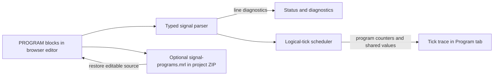

# Browser signal program lab

Date: 2026-11-13. The Program tab now has a separate **Concurrent signal programs** section. It compiles named `PROGRAM` blocks through `frontend/multi-program-language.js` and runs the typed result through `frontend/multi-program-scheduler.js`. The section is a deterministic signal-only teaching tool: program names such as `robot` and `conveyor` label independent counters, but no robot, conveyor, scene object, controller, or physical I/O is driven by these blocks.

The **Load handshake example** button loads the local `testowe/multi_program/handshake.mprg` fixture. **Check signals** shows source-line diagnostics. **Step tick** executes one logical tick; **Run signals** continues from the current tick with a 1000-tick bound; **Reset signals** recompiles and returns to tick zero. The UI shows shared numeric values, terminal status, runtime diagnostics, and a bounded event trace. It renders source and event text with `textContent`, and the parser does not evaluate JavaScript.

Project ZIPs now optionally include `signal-programs.mrl`, named by `project.json.signalPrograms`. An archive without that optional entry opens with an empty signal editor. The archive stores the editable source, not the current tick, counters, signals, or trace. This preserves the version-1 project format and prevents a loaded project from silently resuming a simulated handshake.

The Chromium probe `notes/scripts/check_signal_lab.cjs` loads the six-axis URDF, clicks the example button, checks the program, steps one tick, runs to completion at tick 6 with both signals cleared, downloads and reopens a project ZIP, and repeats the run from tick zero. It also submits an invalid `SET` value containing JavaScript-like text and verifies a line-2 syntax diagnostic without a page error. Its [JSON trace](artifacts/signal_lab.json) and [browser screenshot](artifacts/signal_lab.png) are archived; `tests/signal-lab-browser.test.cjs` repeats the probe. `tests/project-bundle.test.cjs` checks source round trip. The parser and scheduler also have their own focused tests. Runtime timeout and conflicting-write diagnostics retain source lines, while a deadlock lists each blocked program, line, and signal.

Logical ticks are not simulation seconds. Physical device motion, signal-triggered robot moves, and multi-robot playback need an adapter that coordinates timed motion segments with this scheduler and scene state. The current workcell movement program remains the separate single-robot path.
