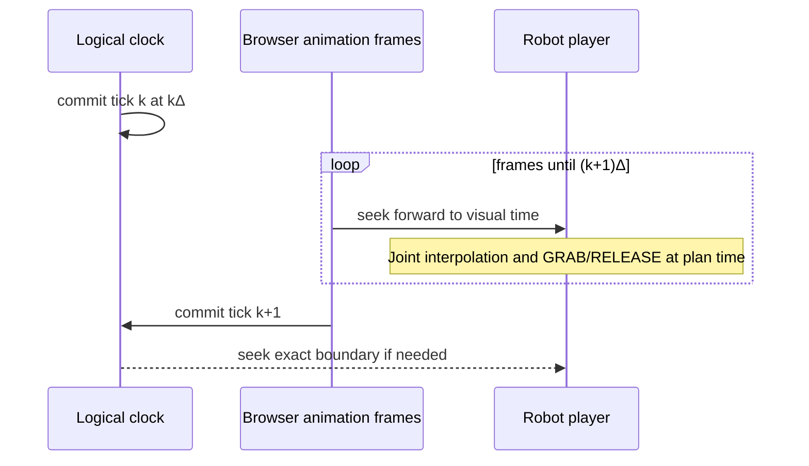

# Smooth visual playback between concurrent ticks — 2026-11-13

The triggered robot controller now keeps two times: committed logical `triggerClock.timeSeconds = tick × tickSeconds`, and monotone displayed `triggerVisualTime` within the current tick. `requestAnimationFrame` seeks the current `ProgramPlayer` forward along its dense timed joint samples between scheduler boundaries. The concurrent scheduler and `MOVE_MODEL` device commands still execute only at boundaries; the browser Worker still freezes the logical clock during planning. This improves rendered robot motion at the default 0.1 s tick without changing the deterministic command or signal trace. [The design note](2026-11-13_subtick_visual_design.md) records the timing invariants.

Pause retains the displayed fractional offset; Resume waits only the remainder of that tick and never seeks backward. Step advances to the next logical boundary. Reset discards the visual state and restores the whole-cycle scene and robot baseline. A generation guard checks before and after an awaited Worker request so an old animation callback cannot restart a new run. If a scheduler tick fails after the robot has visually advanced within it, the displayed pose/time is retained for diagnosis; seeking backward would reload the player's older scene snapshot.

`tests/subtick-playback-browser.test.cjs` uses the real UI and Chromium. It selects a 1 s logical tick for the first visual check so the observation window remains reliable under parallel browser-test load; the normal UI default remains 0.1 s. During the device-first example, at logical tick 7/time 7.000 s the robot player is at local time zero. With Play, while the tick remains 7, the renderer reaches displayed time **7.0954 s**, player local time **0.0954 s**, and base yaw **−0.006049 rad** matching `ProgramPlayer.qAt`. Pause holds that pose and visual time for 160 ms; Resume progresses past tick 8 without rewinding. Reset restores tick zero and yaw zero. The [numeric trace](artifacts/subtick_playback.json) records these states; the [robot screenshot](artifacts/subtick_robot_mid.png) was visually inspected.

The same browser probe restores a 0.1 s tick and advances the delivered-workpiece program to logical tick 72/time 7.200 s, before GRAB. It seeks visual time to **7.243141 s**, just after the planned event at **7.241141 s**. The `pick_box` attaches to the TCP while tick 72 and `clockTime` 7.200 s remain unchanged; Step to tick 73 preserves the attachment, and Reset detaches it. The [GRAB screenshot](artifacts/subtick_grab.png) shows the robot and delivered box. The probe then uses a 1 s tick for the two-run example: during run 2, tick 9 remains at **9.000 s** while the fresh player renders visual time **9.0964 s** and yaw **0.04439 rad**. Pause holds that state; Resume finishes with both completion signals set; Reset restores home. Its [second-run screenshot](artifacts/subtick_second_run.png) is archived. Chromium recorded no page errors. The first and third phases directly verify RAF motion; the GRAB phase uses the same forward-seek method deterministically at a chosen sub-tick event time.

**2026-11-13 amendment:** the browser player now uses the timed position, velocity, and acceleration samples for C2 quintic interpolation; see `notes/2026-11-13_smooth_playback.md`. Device motion remains kinematic at tick boundaries. The clock and UI do not claim physical contact or continuously certified collision safety.
