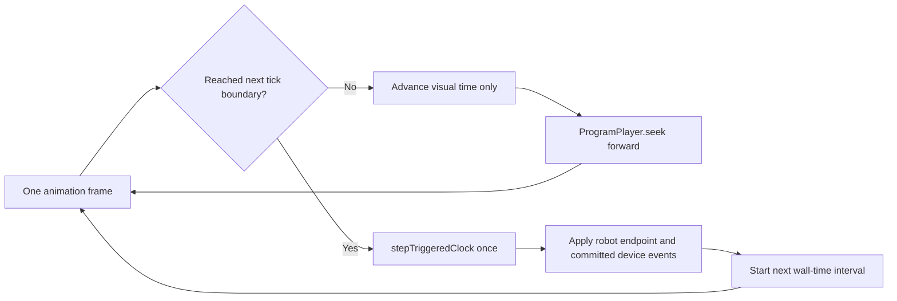

# Smooth visual playback between triggered-program ticks

Date: 2026-11-13. Read-only review of the current `frontend/triggered-clock.js`, `frontend/workcell-ui.js`, and `frontend/program-player.js`. The triggered runtime commits scheduler commands only at fixed logical ticks (`Δ = tickSeconds`, currently 0.01–1 s). `ProgramPlayer.seek()` can render joint interpolation and timed GRAB/RELEASE/WELD_JOIN events between those ticks. The UI currently seeks only after `stepTriggeredClock()`, so the robot appears to jump once per tick.

## Separate committed time from display time

Keep `triggerClock.timeSeconds = kΔ` as the last **committed** scheduler boundary. Add `triggerVisualTime` as an absolute simulation time satisfying

\[
k\Delta \le t_\mathrm{visual} \le (k+1)\Delta.
\]

During Play, one RAF owner advances `triggerVisualTime` according to elapsed wall time, capped at the next boundary. For the current robot run, call `triggerPlayer.seek(clamp(triggerVisualTime - robot.startTime, 0, robot.duration))` only when that local time is at least the player's previous `time` (within a small numerical tolerance). `seek()` also applies scene events at their actual trajectory times, which keeps a carried object attached while the robot moves through a partial tick. The signal/device scheduler is **never stepped** by this display-only seek. Its signals and model positions remain at the last committed boundary until the next tick.

The simplest no-skip loop advances **at most one scheduler tick per RAF**, as the current UI does. If a tab stalls, simulation slows instead of dropping discrete signal/device commands. A bounded catch-up loop is possible later but must apply every intermediate tick and event in order. The visual pose should never cross the next tick boundary before that tick is committed. The active robot can finish within a tick: seek to its exact endpoint time and hold there until the boundary exposes `robot_done` to the scheduler.

## Play, Pause, Step, planning, and Reset

- **Play:** capture the current `triggerGeneration`. Set the wall deadline to `now + ((k+1)Δ - triggerVisualTime)·1000`, preserving a partial interval after Pause. On frames before the deadline, advance only `triggerVisualTime` and seek forward. At the deadline, call `advanceTriggeredTick()`, set visual time to the new committed clock time, and start a new interval. Check the captured generation at callback entry and **again after every awaited tick/Worker operation** before drawing or scheduling another RAF; a stale callback must not attach to a new run.
- **Pause:** cancel RAF and keep both the committed clock and `triggerVisualTime`. The robot stays at the already rendered sub-tick pose. The next Play uses only the remaining fraction of the tick. A paused `robot_done` remains zero until its boundary is committed, even if the robot has visually reached its endpoint inside that tick.
- **Step tick:** cancel RAF, then advance to the next scheduler boundary. Since that boundary is not earlier than `triggerVisualTime`, `ProgramPlayer.seek()` remains forward. Set visual time equal to the resulting committed time. Device positions change only at this boundary.
- **Worker planning freeze:** the `RUN_ROBOT` request commits at a boundary, then status becomes `planning`. Hold `triggerVisualTime` at that boundary and stop wall-clock advancement while the Worker runs. When a plan is accepted, install a fresh `ProgramPlayer`, initialize its local time to zero, and start a new wall deadline. If Pause or Reset invalidates the request, abort and reject the stale Worker result with the existing generation guard.
- **Second `RUN_ROBOT`:** the old player has reached its endpoint. The next request starts at a committed boundary after any device moves have been applied; its Worker snapshot must use the current scene/q. Install a **fresh** player, reset `triggerVisualTime` to the frozen request boundary, and compute local display time using the new `robot.startTime`. Never seek the old player backward or call `ProgramPlayer.load()` on it, because `load()` resets its old world snapshot.
- **Reset:** cancel RAF, abort planning, increment generation, discard the player, restore `triggerBaseline` (world, attachments, q), and construct a new clock. Do not use `ProgramPlayer.reset()` on a partial run: it reloads only that robot plan's local world snapshot and can erase earlier device moves.

The application must keep normal `player.play()` and the triggered RAF mutually exclusive. `ProgramPlayer.seek()` at the exact plan end changes its own state to `finished`, but does not cancel the triggered RAF; the latter remains responsible for reaching the next scheduler boundary and publishing `robot_done`.

## Error and event boundary invariants

`stepTriggeredClock()` is pure and detects an unsafe overlapping `MOVE_MODEL` before applying its returned state. The display-only robot may have progressed through the preceding partial interval when an error is discovered at the next boundary. Do not try to roll it back by calling `ProgramPlayer.seek()` with a smaller time; that calls `restoreStart()` and reloads the SDF world. Instead, stop Play and report the reached visual time alongside the scheduler error. If strict no-visual-progress-on-error semantics are required, preflight the next pure scheduler tick before rendering the interval.

All robot scene events should be applied **once** by forward `seek()` at their actual plan times, including events between logical boundaries. At the boundary, `applyTriggeredResult()` may call `seek()` to the same local time; the event cursor prevents duplicate attaches/releases. Device poses are applied only from committed `MOVE_MODEL` events, after the robot seek. The runtime already rejects overlapping device motion during an active robot plan. Do not call the all-device `applySceneDevices()` on every visual frame: it would overwrite or reject a GRABbed movable object.

Use a numerical tolerance for monotonicity and clamp `triggerVisualTime` to `[clock.timeSeconds, clock.timeSeconds+Δ]`. A new player starts at local zero; the old player's time must never be compared with it. If `seek()` throws during a visual frame, stop the RAF and report the error without committing another scheduler tick.

## Browser verification

In Chromium, use a deliberately long logical tick (1 s) for the RAF sampling phases, so the test can reliably observe several rendered frames inside one committed tick even under parallel test load. A planned segment may be shorter than that tick. During Play, sample at two RAF frames with the same `triggerClock.tick`; assert strictly increasing displayed joint angle and `triggerPlayer.time`, while `schedulerState.tick` and device pose stay unchanged. Pause mid-tick, verify time/q hold, Resume and verify the next boundary occurs after only the remaining fraction. Step from a partial tick and check one scheduler tick, no backward player seek, and exact endpoint. Test a GRAB event located between tick boundaries with 0.1 s ticks: it attaches once at its trajectory time and its object follows the sub-tick arm pose. Then run the two-request fixture and verify a fresh player also renders between ticks in the second run; pause/resume and reset must preserve the clock contract. Archive a short frame trace plus intermediate screenshots; a single final screenshot cannot prove visual smoothness. The completed browser trace is in `notes/2026-11-13_subtick_visual_browser.md`.
