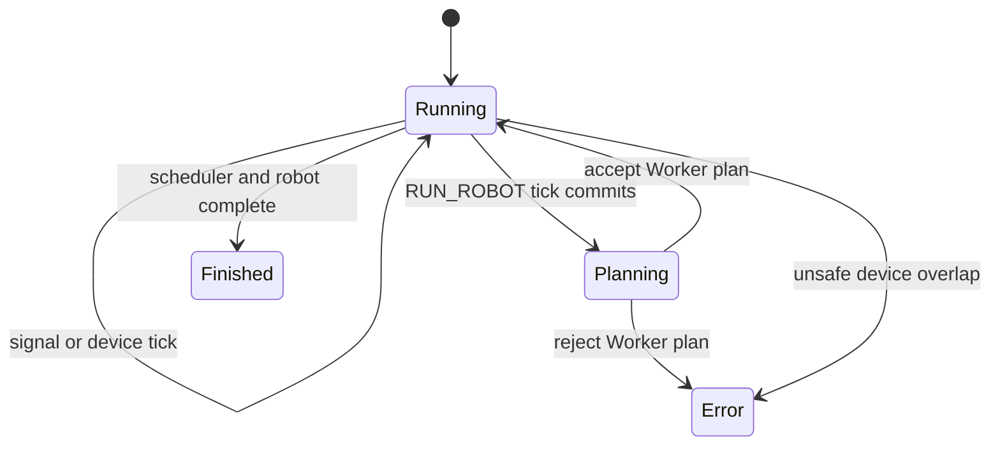

# Command-time robot clock core — 2026-11-13

`frontend/triggered-clock.js` is a pure state machine for a device-first concurrent program that later requests a robot movement program. It does not call the planner or mutate Three.js. The browser orchestrator applies accepted `MOVE_MODEL` events to the scene, calls the planning Worker at a `RUN_ROBOT` request, and supplies the planned samples back to the clock.

```js
let clock = createTriggeredClock({ schedulerState, initialQ, tickSeconds: 0.1 });
let step = stepTriggeredClock(clock);              // one committed logical tick
clock = step.state;
if (step.request) {
  // Worker plans the frozen movement source against the scene at step.request.timeSeconds.
  clock = acceptRobotPlan(clock, { samples: workerPlan.samples, events: workerPlan.events });
  // Or: clock = rejectRobotPlan(clock, { code, message });
}
```

The scheduler originally had one `RUN_ROBOT` command per triggered run; the later [multi-request extension](2026-11-13_multi_request_clock.md) permits sequential requests. At a request tick end the clock becomes `planning`, returns `{program,line,tick,timeSeconds}`, and refuses to advance while the asynchronous Worker runs. Successful acceptance requires finite, strictly increasing local plan times from zero and, when `initialQ` was supplied, the first planned joint vector must match within $10^{-6}$ in the same joint order. The plan starts at the request boundary. Failure becomes a terminal, source-located diagnostic through `rejectRobotPlan`.

After acceptance, `stepTriggeredClock` interpolates `q` from the plan's timed samples. The read-only `robot_done` signal becomes one at the first logical tick boundary on or after the robot endpoint; a `WAIT_SET robot_done` reads it at the next tick start. An untimed wait does not falsely deadlock while a robot plan is active, and timed waits count simulation ticks. A scheduler that finishes immediately after `RUN_ROBOT` keeps the combined clock running through the endpoint boundary. A zero-duration plan completes immediately.

The clock checks a tentative scheduler transition before committing. `MOVE_MODEL` during an active robot trajectory yields `UNSAFE_DEVICE_TIMING` with source line and leaves the rejected tick's robot q, signal map, and device positions unchanged. A device may move a model before the robot GRABs it. After a GRAB/RELEASE/WELD_JOIN, a later device command for that model gets `ROBOT_OBJECT_DEVICE_CONFLICT` until the browser calls `syncTriggeredDevices` with a fresh detached world origin after robot completion. The check also uses the computed completion boundary, covering a very short plan whose phase flag has not yet changed from `moving`. The sync updates the scheduler's origin without moving the scene object. Simultaneous moving-body collision checking and device sweep checks remain outside this core.



`tests/triggered-clock.test.cjs` covers device-first movement, a device move committed in the same tick as `RUN_ROBOT`, frozen request time, endpoint and wait ordering, interpolation, atomic overlap failure, Worker rejection, early-finished scheduler, zero-duration plan, read-only signal, exactly-one-request rule, robot-carried model origin synchronization, first-boundary behavior for a very short plan, and immutable prior state. Focused run: **10/10 passed**. Browser Worker integration and rendered motion remain to be verified by the parent agent.
