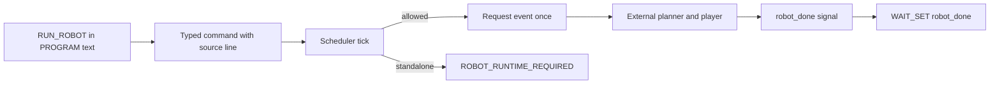

# `RUN_ROBOT` request in concurrent programs — 2026-11-13

`frontend/multi-program-language.js` accepts `RUN_ROBOT` with no arguments inside a `PROGRAM` block. It compiles to `{kind:'RUN_ROBOT', line}`. Extra arguments receive `RUN_ROBOT_SYNTAX` at the source line. The command names the currently authored movement program implicitly; it does not contain JavaScript or arbitrary source to evaluate.

`frontend/multi-program-scheduler.js` treats this as a request for an **external timed robot runtime**. `stepMultiProgram(state, {allowRobotRequest:true})` emits `{kind:'RUN_ROBOT', outcome:'request', tick, program, pc, line}` and advances that program counter once. A following `WAIT_SET robot_done` can block while the external runtime plans and plays the move; the orchestrator passes `externalPendingSignals:['robot_done']` to prevent a false deadlock on an untimed wait. Two `RUN_ROBOT` commands dispatched in the same logical tick yield `ROBOT_REQUEST_CONFLICT` with both source locations and no committed events or signal/device changes.

Without `allowRobotRequest:true`, reaching `RUN_ROBOT` yields a line-located `ROBOT_RUNTIME_REQUIRED` error, leaving the command counters, signal map, and device state at the previous accepted tick. This keeps the standalone signal lab from silently treating a robot request as physical movement. The scheduler emits a request; planning, clock ownership, `robot_done` publication, and collision validity belong to the orchestrator and are not implemented by this parser change. The root agent owns that integration.

Focused parser, scheduler, and existing shared-clock tests passed **27/27** after the change. The new cases check exact typed parsing, malformed arguments, request event and counter advance, standalone rejection, source-line reporting, same-tick atomic conflict, and waiting on externally pending `robot_done`.
