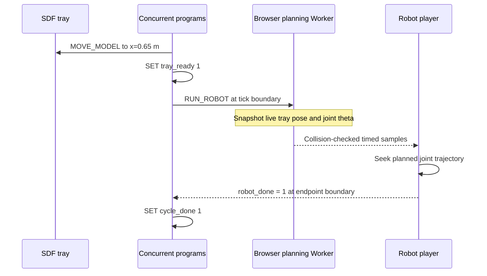

# Device-first command-time robot execution — 2026-11-13

The Program tab now has a **Command-time robot run** section. A concurrent-program `RUN_ROBOT` command requests the movement program shown above it. The request is accepted at a logical tick boundary. The browser applies that tick's committed SDF model poses, freezes simulation time, then sends the movement program and a snapshot of the **current** robot joints, model frames, and collision geometry to the existing planning Worker. The result runs through a fresh `ProgramPlayer`, whose scene baseline is the postdevice state. `robot_done` is a read-only signal for later WAIT commands.

The **Load device-first example** button loads the six-axis URDF, a conveyor SDF scene, a robot `MOVEJ` source, and two concurrent programs in `testowe/multi_program/triggered.mprg`. One program moves the tray for four ticks and sets `tray_ready`; the other waits for that signal, issues `RUN_ROBOT`, waits for `robot_done`, and sets `cycle_done`. At 0.1 s per tick, the robot starts at 0.70 s after the tray reaches world X = 0.65 m. The planned robot duration is 0.548 s. A `MOVE_MODEL` during that trajectory fails before the unsafe tick commits, with its source line. A plan failure reports both the requesting `RUN_ROBOT` line and the movement-program diagnostic while leaving the delivered tray and robot at the dispatch state.

The triggered controller owns its animation-frame loop and a cancellable Worker request. Pause freezes simulation ticks; Reset aborts a pending Worker request, ignores any stale response, restores the whole run's initial SDF poses, attachment relationships, and independent robot joints, and prepares tick zero again. Editing either source, loading another scene/robot/project, or taking ordinary controls stops triggered ownership. Project ZIP saves the current physical poses and both editable programs, not a running controller checkpoint.

The Chromium probe `notes/scripts/check_triggered_robot.cjs` captures the actual Worker request and asserts tray world X = 0.65 m and robot joint theta at planning time. It also tests a manually changed 0.05 rad start joint, a line-located planning failure, unsafe overlap, Pause, Reset during a deliberately delayed Worker response, and ZIP reopen. Its numeric [trace](artifacts/triggered_robot.json) and [device-first](artifacts/trigger_device_mid.png), [robot-mid](artifacts/trigger_robot_mid.png), and [finished](artifacts/trigger_final.png) screenshots are archived. `tests/triggered-robot-browser.test.cjs` repeats the probe; the parser/scheduler/core have focused tests.

A second [delivered-workpiece fixture](2026-11-13_delivered_workpiece.md) moves a loose `pick_box` from X = 0.20 m to X = 0.42 m before `RUN_ROBOT`. Chromium captures the Worker snapshot at the delivered pose, then verifies GRAB, visible carry, RELEASE, the Workcell attachment label, and whole-cycle Reset. This covers a device-delivered object that the robot later handles; the core also prevents a stale postcarry device command until the scene pose is synchronized.

This path plans one robot movement program on demand after kinematic device movement. It still prohibits a device move during the planned robot trajectory; the device's own sweep has no acceleration or swept collision checking. Multiple `RUN_ROBOT` requests, simultaneous moving-body planning, physical I/O, and closed-loop robot kinematics remain open.
