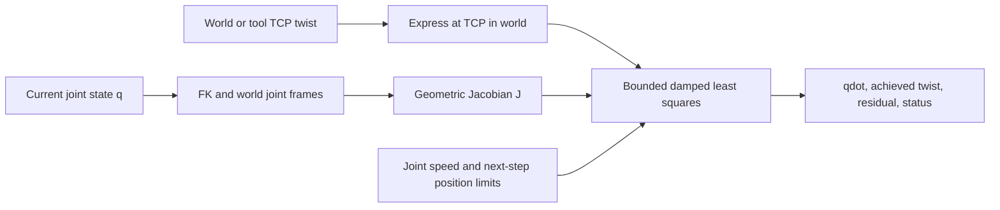

# Inverse velocity kinematics for a serial TCP

Date: 2026-11-13. Implementation: `frontend/planning/velocity-ik.js`. This is a kinematic teaching and pendant primitive, not a dynamics or safety controller.

The active URDF chain model already exposes a world-frame forward pose and joint frames. `geometricJacobian(model, q)` returns a $6\times n$ matrix with rows ordered $[v_x,v_y,v_z,\omega_x,\omega_y,\omega_z]$ and columns in `model.jointNames` order. For revolute joint $i$, with world-axis $a_i$, pivot $p_i$, and TCP origin $p_T$, its column is $[(a_i\times(p_T-p_i))^\mathsf T,\ a_i^\mathsf T]^\mathsf T$. For a prismatic joint it is $[a_i^\mathsf T,\ 0,0,0]^\mathsf T$. These are geometric TCP velocities, not Euler-angle derivatives.

`solveVelocity(model, q, twist, options)` accepts a six-vector with linear m/s and angular rad/s components. `frame: 'world'` means the values are world-axis components. `frame: 'tool'` rotates each three-vector from the **current** TCP basis into world before solving; since the linear velocity is specified at the same TCP origin, there is no lever-arm term. The inverse mapping rotates the achieved and residual twists back into the requested frame. This differs from a spatial twist whose linear component is defined at the world origin.

The solver minimizes $\lVert W(J\dot q-\xi)\rVert^2+\lambda^2\lVert\dot q\rVert^2$ with $W=\operatorname{diag}(1,1,1,w_R,w_R,w_R)$, default $w_R=0.25\,\mathrm{m/rad}$ and damping $\lambda=10^{-4}$. It bounds each rate by the supplied `velocityLimits` (or `limits.velocity`) and by the joint position that would result from one Euler step of `dt` seconds (default 0.05 s). An active-set solve locks a joint at a violated bound, then recomputes the remaining free rates. This does **not** silently scale the whole command. The returned `qdot`, `nextQ`, `achieved`, `residual`, `translationError`, `rotationError`, `rank`, and `limitedJoints` let the caller show what the robot can actually do.

`status: 'solved'` means the requested twist is met within default 0.0001 m/s and 0.001 rad/s residual tolerances, possibly with a bound active. `limited` means a velocity or position bound prevents that tolerance; `singular` means the local Jacobian cannot realize the request even without an active bound. `invalid_target` and `numerical_failure` are typed failures. A pendant should apply a step only after choosing an explicit policy for `limited`/`singular`; the core returns the best bounded approximation but does not move the robot or check collisions. Continuous jogging needs repeated solve/evaluate steps and fresh collision checks at each step.

Evidence: `tests/velocity-ik.test.cjs` checks an analytic one-joint Jacobian, equivalent world/tool commands at a rotated tool, a transverse singular direction, velocity and near-bound position caps, a feasible six-axis twist on a rotated base, and malformed input. Six tests pass. The serial model permits revolute, continuous, and prismatic joints. The separate planar four-bar constraint must use independent-coordinate closure derivatives rather than this serial Jacobian.
