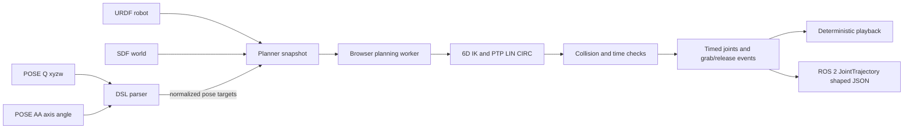

# Browser workcell roadmap and decision ledger

Date: 2026-11-13. Repository: `modelrobot_internal` (separate remote from `modelrobot`). This file is the handoff ledger for agents implementing the agreed plan. Record each completed task with the test or browser evidence that proves it. A checkbox is not evidence by itself.

## Goal and acceptance scenario

A student can load a URDF manipulator and an SDF workcell, define named TCP targets, write a small movement program, and preview and execute collision-checked PTP, LIN, and CIRC moves entirely in the browser. The program can grab a workpiece, carry it, and release it. Execution is deterministic, can be paused/stepped/reset, and can export the project and a ROS 2 `JointTrajectory`-shaped JSON record. Unsupported inputs and infeasible moves produce precise diagnostics. Existing URDF editing, joint controls, CSV animation, and saved robots remain usable.

The first end-to-end browser acceptance case must include a circular move and pick-and-place. The scene and robot should be visually inspected with Playwright/Chromium, with screenshots in `notes/artifacts/`, in addition to automated assertions.

## Decision ledger

| ID | Decision | Reason / consequence | Status |
|---|---|---|---|
| D-01 | Work only in the existing `modelrobot_internal` copy and its different remote. No push. | Preserve `modelrobot` and keep changes reviewable. | Accepted |
| D-02 | Browser-only compute and storage for the first release. Use workers for costly IK/planning. | Imported files stay local; offline teaching use. No ROS 2 server is required. | Accepted |
| D-03 | Use URDF for robot descriptions and a documented SDF world subset for scene import/export. Export SDF 1.10; accept supported elements in 1.8–1.12. Package the SDF, URDF, STL, program, settings, and manifest in a project ZIP. | Familiar ROS/Gazebo concepts with honest parser limits. Unsupported SDF is reported, never silently treated as simulation. | Accepted |
| D-04 | First student language is a small, parsed robotics DSL. Compile it to a typed command model; do not execute arbitrary JavaScript. | Clear source-line errors and deterministic replay. A Python-like front end can target the same model later. | Accepted |
| D-05 | First workflow includes PTP, LIN, CIRC, full position-and-orientation IK, scene collisions, grab/release, and smooth individual moves. Stop at program command boundaries. | A complete pick-and-place lesson with circular motion; corner blending is a later feature. | Accepted |
| D-06 | PTP may detour around obstacles. LIN and CIRC preserve their specified TCP geometry and fail visibly if it is infeasible. | Avoid silently changing an industrial path. | Accepted |
| D-07 | First collision/planning layer is a browser educational simulator, not a certified safety checker. Use explicit collision geometry, report missing shapes, check planned paths adaptively, and disclose the remaining between-sample limit. | Current OBB warnings alone cannot validate a path. | Accepted |
| D-08 | Welding is a later process-path workflow with seam visualization/events and optional rigid attachment after a weld. | No thermal, contact-force, or fused-body dynamics are implied. | Accepted |
| D-09 | Preserve the legacy single active robot UI through a compatibility adapter while new scene state supports multiple instances. | Existing CoffeeScript, CSV, pose tool, and tests are coupled to `window.robot`. | Accepted |
| D-10 | Keep application physics/trajectory behavior local. Do not use Ruckig Community intermediate waypoints because that route invokes a cloud API. | Offline operation is a hard requirement. | Accepted |
| D-11 | Store target orientation as a normalized xyzw quaternion internally; accept quaternion and angle-axis pose input. | Both representations drive the same IK target; angle values are radians. | Accepted |
| D-12 | Add `WELD ON object` / `WELD OFF` as a kinematic process-path annotation bound to a scene object, with TCP surface-distance checks and a separate process JSON export. | Implements the seam/event part of D-08 while keeping force, heat, material joining, and post-weld rigid attachment for later work. | Implemented 2026-11-13 |
| D-13 | Add optional `WELD JOIN child parent` after a completed seam as a permanent kinematic relationship for the current scene, and preserve the relationship in project ZIP files. | Makes the welded assembly carryable as a group; it does not simulate fused material, contact force, or thermal effects. | Implemented 2026-11-13 |
| D-14 | Persist independent robot joint positions in an optional `robot-state.json` project ZIP entry, restoring them before scene attachments. | A reopened carried assembly retains robot configuration and object world poses; older ZIPs remain readable at URDF home. Playback time and dynamic state are not archived. | Implemented 2026-11-13 |
| D-15 | Add `ZONE r` in metres (0–0.2 m) as an optional bounded flyby between consecutive MOVEJ/PTP commands. Both moves must allow a positive zone; zero or intervening process/scene commands preserve the D-05 exact stop. | The browser rule is explicitly different from EASY-ROB's documented millimetre setting, whose numeric blend law remains unresolved. Checked quintic joint splices keep the TCP near the waypoint and original path; infeasible requested blends fail visibly. | Implemented 2026-11-13 |
| D-16 | Give future device programs separate counters and a shared numeric signal map under deterministic logical ticks. Reads use the tick-start snapshot; writes commit together, with conflicts diagnosed. | This establishes a testable scheduling contract without claiming EASY-ROB's unknown same-tick order or prematurely tying logical ticks to browser frame time. | Foundation implemented 2026-11-13 |
| D-17 | Expose typed signal-only `PROGRAM` blocks in a separate browser lab and archive their source in an optional project ZIP entry. | Students can inspect deterministic handshakes now, while the UI explicitly says it does not drive a device or robot until a timed motion adapter exists. | Implemented 2026-11-13 |
| D-18 | Add `MOVE_MODEL name X\|Y\|Z coordinate TICKS N` for detached, nonstatic SDF models in the concurrent program lab. Interpret coordinate in the world frame, interpolate linearly per logical tick, and apply committed poses to the browser scene. | This supplies a concrete kinematic device program path with deterministic signal handshakes. A tick remains an abstract scheduler unit; acceleration, collision checks, physical I/O, and robot-program coupling require later work. | Implemented 2026-11-13 |
| D-19 | Use a single browser simulation clock to replay an already planned robot trajectory and advance concurrent programs at a selected seconds-per-tick interval. Expose a read-only `robot_done` signal; reject device moves before the robot plan ends. | This yields deterministic time alignment while preserving the fixed-scene collision assumption of the current planner. Planning a robot after a device move and checking truly simultaneous moving bodies remain later work. | Implemented and reviewed 2026-11-13 |
| D-20 | Add typed `RUN_ROBOT` to concurrent programs and plan the frozen movement source in the browser Worker when the request is reached, after committed device moves. Freeze simulation time while planning; use a fresh player and whole-run reset baseline. | The Worker sees current SDF poses and joint values, enabling device-first sequences with collision-checked robot motion. Reject overlapping device movement, reserve read-only `robot_done`, and permit one request per run until multi-request semantics are designed. | Implemented and reviewed 2026-11-13 |
| D-21 | Extend D-20 to sequential `RUN_ROBOT` requests in one triggered cycle. Replan the same frozen movement source from the current scene and joints at each request, rearm `robot_done` to zero, and use a fresh player. | A program can interleave completed robot work with kinematic device motion. Active robot overlap and same-tick request conflicts stay atomic errors. `robot_done` is a level signal, so different programs need an explicit handshake if they might read the prior completion on the tick of a new request. | Implemented and reviewed 2026-11-13 |
| D-22 | Extend metre-based `ZONE r` to one consecutive LIN/CIRC pair with effectively fixed TCP orientation. Keep exact incoming/outgoing line or arc geometry outside a fifth-degree Bézier transition bounded by the waypoint ball, preserve CIRC via poses, and retime the pair as one trajectory. | This adds a nonstopping Cartesian corner without silently changing the rest of the path. Weld-active, changing-orientation, and overlapping three-move blend requests fail visibly. The declared geometric envelope is continuous; joint limits, FK residuals, and collisions still use sampled/adaptive checks. | Implemented and reviewed 2026-11-13 |
| D-23 | Render triggered robot motion at animation-frame times between logical scheduler ticks, while keeping signals and kinematic device commands at tick boundaries. Keep displayed time monotone across Pause/Resume/Step; freeze it during Worker planning. | Students see the dense planned trajectory and GRAB/RELEASE at their timed event positions without changing deterministic concurrent-program state. A failing tick may leave the robot visually ahead of the last committed scheduler time; report displayed time instead of rewinding scene state. | Implemented and reviewed 2026-11-13 |
| D-24 | Extend D-22 Cartesian ZONE to changing orientation using a shortest-branch SO(3) rotation-vector transition with continuous body angular rate at the two cuts. Preserve exact inbound/outbound orientation references and CIRC via poses, and enforce a conservative declared-orientation angular-speed bound (default 1 rad/s). | The ZONE radius remains a positional waypoint ball in metres; it does not bound angular deviation. Position reference is C2, orientation reference C1; realized FK, limits, and collisions remain sampled/adaptive. Exact 180° sign choice and original CIRC via angular-rate jumps remain. | Implemented and reviewed 2026-11-13 |
| D-25 | Compose three or more consecutive positive-ZONE LIN/CIRC commands into one Cartesian reference and one timed IK trajectory. Preserve every CIRC via, use nonoverlapping local corner trims, and return one source move plus one blend record per corner. | Chaining separately timed pairs would stop at their shared endpoint. A `ZONE 0` or process command ends the run. Collision checks apply to the realized flyby, so an occupied nominal waypoint need not block a valid bypass. | Implemented and reviewed 2026-11-13 |
| D-26 | Treat a prismatic rail upstream of the TCP in the same serial URDF chain as an active robot joint, subject to its URDF limit and coordinated trajectory timing. | The existing full-pose IK and player already support this case. Separately controlled external axes, multi-robot coordination, and closed-loop mechanisms require a different scene/kinematic model. | Browser-verified 2026-11-13 |
| D-27 | Before committing each `MOVE_MODEL` logical tick, sample every proposed same-tick detached-model translation together against SDF and current robot collision geometry at no more than 5 mm relative translation per sample (2000-sample cap). Include attached descendants and mounted robots; reject a collision or sample-budget overflow atomically. | A device previously crossed a static wall between clear endpoints. Signal, shared, and triggered modes now share the same precommit rule, while shared Play applies skipped logical ticks one at a time. The check remains sampled and kinematic; no acceleration/contact model is implied. | Implemented and reviewed 2026-11-13 |
| D-28 | Permit an explicit URDF robot-base mount to an SDF model/link frame with a stored rigid local pose. `MOVE_MODEL` can carry that robot before a later `RUN_ROBOT` request; the Worker snapshots the shifted base. Archive the mount in optional `robot-mount.json` and retain it across SDF reload, URDF reparse, Reset, and project reopen. | This covers a separately programmed external carrier without treating it as a robot `JointTrajectory` joint or allowing simultaneous carrier/robot motion. A declared fixed base/carrier assembly may have internal collision contact; moving links and outside objects remain checked. Attachment cycles through the mount fail in planning preflight. | Implemented and reviewed 2026-11-13 |
| D-29 | Represent a planar four-bar as a valid cut-tree URDF plus optional `kinematic-constraints.json` with an assembly branch. Plan and archive only its independent input angle; solve passive joint values for every collision query, timed state, and rendered frame. | This supports one explicit closed loop without pretending that URDF itself has a graph cycle. The first constrained planner supports MOVEJ, PAUSE, GRAB/RELEASE and full-pose IK at a closure endpoint. LIN/CIRC, welding and positive ZONE return typed diagnostics for this one-DOF mechanism. All three joint rates and accelerations limit timing at samples; collision checking remains sampled. | Implemented and browser-verified 2026-11-13 |
| D-30 | Replay timed joints with a quintic Hermite segment matching stored position, velocity, and acceleration at each knot. Validate the replay interpolant at interior fractions for limits, FK residuals, and collisions. | A displayed trajectory now retains the planner's C2 joint motion instead of silently replacing it with straight sample-to-sample segments. Checks are sampled, not an analytic continuous certificate. | Implemented and browser-verified 2026-11-13 |
| D-31 | Bundle startup URDF and advertised text examples; use a local planner fallback for ordinary `file://` launch when a browser Worker cannot start. | The first-release classroom workflow works by opening `standalone.html` directly without a server or browser flags. File-origin planning can briefly block the UI; HTTP keeps the cancellable Worker. | Implemented and browser-verified 2026-11-13 |
| D-32 | Present the planar four-bar example from above and draw visual-only hinge pins across its separated Z layers. | The one-DOF closure was numerically correct but an edge-on camera made the stacked link solids look detached. Pin visuals explain the mechanism without changing its URDF tree, collision shapes, or closure equations. | Implemented and browser-verified 2026-11-13 |
| D-33 | Add serial-robot inverse velocity IK and a detachable virtual teach pendant with Joint/World/Tool modes, bounded speeds, sampled collision checks, and captured pose/joint targets. Also expose tool-relative targets in the direct full-pose panel. | Students can control the classroom arm in joint, absolute world-pose, and tool-relative modes, see achieved TCP/joint feedback, and teach editable motion commands. Manual jog remains discrete kinematic control; program replay has its own timed planner. The blue paired keypad borrows the useful axis/coordinate grouping from the user-provided FANUC photo without copying unrelated hardware keys. | Implemented and browser-verified 2026-11-13 |

Change a decision by adding an amendment here with a date and evidence; do not silently overwrite the old rationale.

### Education and state review amendment (2026-11-13)

**Teaching packet follow-up (2026-11-14).** A standalone Polish, nine-page LaTeX/PDF guide now covers seven exercises and a command/state quick reference: `notes/artifacts/starter_lab_pl/main.tex` and `mymodelrobot_cwiczenia.pdf`; portable bundle `notes/artifacts/mymodelrobot_cwiczenia_pakiet.zip`. Inspiration is a user-provided PŁ lab instruction; students need no knowledge of another application. The exact new triangle/arc path, alternate via height, obstacle rejection and early-GRAB diagnostic were run in Chromium. A vague IK `disallowed configuration` reason was repaired to identify collision/state validation, retaining solver behavior.22/22 planner/collision tests pass. Build/render/portable-rebuild and exercise evidence are in `notes/2026-11-14_starter_lab_document.md` and `notes/2026-11-14_starter_lab_paths_validation.md`.

Three independent reviews (`2026-11-13_education_review.md`, `2026-11-13_workflow_review.md`, `2026-11-13_state_review.md`) found missing novice workflow, ambiguous start semantics, conflated last-message/plan/kinematic state, and an incorrect inference that every infeasible twist is singular. Repairs add a guided two-pose lesson, explicit instantaneous teaching-start reset, persistent lifecycle and configuration health, retained failed jog diagnostics/recovery, and distinct source TOOL context. Source edits and replanning now preserve the displayed pose by default; comparative planning tests explicitly Reset before replanning from the old baseline. Collision visualization is labelled as warnings while planner/pendant checks remain enabled.

`jacobianHealth` uses a declared 0.25 m characteristic length and scaled task singular values (warning ratio 0.02); it distinguishes low-DOF task limitation from rank deficiency. Rank deficiency is relative to min(6,n), not a proof of an isolated singular configuration for arbitrary imported mechanisms. The bounded velocity solve remains a damped clamping heuristic, not a global QP optimizer. Evidence: `tests/jacobian-health.test.cjs`, `tests/velocity-ik.test.cjs`, `tests/learning-workflow-browser.test.cjs`, `notes/artifacts/learning_workflow.png`, and `learning_singular_recovery.png`.

The subsequent requested Astra review proved large-step Cartesian drift despite a successful instantaneous solve. `jog-integration.js` now uses adaptive <=10 ms substeps, FK increment checks and atomic rejection; pendant collision checking follows its full integrated polyline. Joint-limited feasible twists slow uniformly down to a minimum 1/32 rather than applying a different direction. Manual joint rates are capped for teaching and J7+ is paged. The classroom pick-and-place now starts in a verified bent collision-clear posture; an optional straight-posture exercise explains singular-direction recovery. Numerical and browser evidence: `tests/jog-integration.test.cjs`, `tests/kuka-import-browser.test.cjs`, `tests/official-ur5-browser.test.cjs`. Real KUKA iiwa and official ROS 2 UR5 fixtures, licenses and provenance are archived; adapted STL-visual workcell ZIPs reopen with exact saved posture and local meshes. Raw OBJ/DAE visual imports remain unsupported. See `2026-11-13_education_repairs.md` for scope and use cases.

## Interfaces to converge on

- World frame is Z-up; lengths are metres, angles radians, and poses carry explicit frame names. A planning request snapshots robot joints, scene transforms, collision shapes, active tool, and motion limits.
- Scene module: parse/serialize supported SDF world data; own named frame/object relationships and preserve world transform on attachment or release.
- IK/planning module: take serializable robot data and a target pose, return joint solution and numeric residuals or a typed failure; plan PTP/LIN/CIRC as sampled joint paths and timed trajectories through a synchronous collision-query interface.
- Program module: parse source with line locations into commands (`ROBOT`, `TOOL`, `MOVEJ`, `MOVEL`, `MOVEC`, `PAUSE`, `GRAB`, `RELEASE`, `WELD`, `ZONE`); preflight commands against a scene snapshot; emit motion segments and timed scene/process events.
- Program text syntax is `POSE name frame x y z Q qx qy qz qw` or `POSE name frame x y z AA ax ay az angle` (bare `qx qy qz qw` is also accepted), `JOINTS name joint=value ...`, then `ROBOT name`, `TOOL name`, `MOVEJ target`, `MOVEL pose`, `MOVEC via_pose end_pose`, `PAUSE seconds`, `GRAB object`, `RELEASE object`, `WELD ON object`, `WELD OFF`, and `ZONE radius_m`. Quaternions are xyzw; axes and quaternions are normalized by the parser. Names are case-sensitive. The `frame` token names the reference frame in which the pose coordinates are expressed; `world` is valid. `#` begins a comment. See `frontend/program.js`.
- Browser UI: preserve the existing URDF, Files, Joints, and Animation tools while adding scene, targets, and program controls. Manual sliders, CSV playback, pose editing, and program playback have explicit ownership so simultaneous controls cannot silently fight over joints.

### Orientation and pose convention

The named `POSE` is the TCP pose in a named reference frame `F`. Its position is in metres and its rotation maps TCP coordinates into `F`; the world target is composed as ${}^{W}T_T = {}^{W}T_F\,{}^{F}T_T$. Code stores the rotation as a unit quaternion in `xyzw` order. For angle-axis input, let the supplied axis be $a\in\mathbb R^3$ and the angle be $\theta$ radians. With $\hat a=a/\lVert a\rVert$,

$$q_{xyzw}=\left(\hat a_x\sin\frac{\theta}{2},\;\hat a_y\sin\frac{\theta}{2},\;\hat a_z\sin\frac{\theta}{2},\;\cos\frac{\theta}{2}\right).$$

For example, `POSE turn world 0.4 0.2 0.8 AA 0 0 1 1.57079632679` and `POSE turn world 0.4 0.2 0.8 Q 0 0 0.7071067812 0.7071067812` define the same target to numerical precision. $q$ and $-q$ also encode the same physical rotation; the parser normalizes and chooses nonnegative $q_w$ where its sign distinguishes the pair. At 180°, $q_w=0$ and the axis sign remains nonunique. A zero angle accepts a zero axis; any nonzero angle requires a nonzero axis. Both forms feed the same six-dimensional IK and Cartesian path code. `AA` is convenient for handwritten quarter turns; `Q` is convenient for software-generated poses and stable interpolation. LIN and CIRC interpolate orientation along shortest quaternion arcs, so AA angles above 180° do not command extra turns; see `notes/2026-11-13_pose_orientation.md`.

Equivalence, 180° sign ambiguity, and the same-seed IK branch are checked in `notes/2026-11-13_pose_orientation.md` and the parser/planning tests.

## Task ledger

| Task | Owner | State | Completion evidence required |
|---|---|---|---|
| T-01 Record decisions and agent handoff | Root | Complete | This ledger and `AGENTS.md` exist; reviewer confirmed the decisions and handoff conventions |
| T-02 SDF scene model, transforms, attachment | Scene agent | Complete | `tests/sdf.test.cjs` and `tests/scene-model.test.cjs` pass; Chromium `notes/artifacts/browser_arm_scene.png` shows the arm and four objects |
| T-03 Six-dimensional IK and PTP/LIN/CIRC geometry | Planning agent | Complete | `tests/planning.test.cjs` passes 8 cases covering FK residuals, limits, CIRC via point, and timed moves; browser screenshots for PTP, LIN, and CIRC |
| T-04 Planner collision query and obstacle-aware PTP | Planning/root | Complete | `tests/planning-collision.test.cjs` passes 7 cases; obstructed PTP routes, blocked Cartesian paths fail, and carried-object contact is checked; remote GRAB fails by distance |
| T-05 Timed motion with velocity/acceleration checks | Planning/root | Complete | Timing tests verify bounds and zero endpoint derivatives; browser demo exports 3281 timed samples over 31.391861533 s with zero endpoint derivatives |
| T-06 DSL parser, diagnostics, command model | Root | Complete | `tests/program.test.cjs` passes, Worker preflight reports source lines, and browser Q/AA equivalents give endpoint joint states within about $10^{-14}$ |
| T-07 Integrate multi-object workcell, editor, preview, playback | Root | Complete | `tests/workcell-demo.test.cjs` passes actual Chromium pick, CIRC, LIN, release and reset; screenshots `notes/artifacts/demo_program_placed.png` and `browser_demo_carry.png` inspected |
| T-08 Project ZIP + IndexedDB save/restore + trajectory export | Root | Complete | `tests/project-bundle.test.cjs` and `notes/scripts/browser-project-store.cjs` pass; browser ZIP/open and trajectory download verified by reviewer |
| T-09 Regression, offline, usability and visual review | Reviewer/root | Complete | `npm run build` succeeds; final full `npm test` passes 220/220 after T-33 (log `notes/artifacts/test_full_pendant_keypad_final.log`). Test runner concurrency is capped at four so many Chromium processes do not starve timing-sensitive playback tests. `tests/manual-handoff.test.cjs` verifies no external browser requests and stale playback invalidation; reviewer archived visual results in `notes/2026-11-13_browser_workcell_review.md` and `notes/2026-11-13_pendant_review.md`. |
| T-11 Direct full-pose TCP control | Root | Complete | Program tab reads a selected link's world pose and plans a PTP or LIN target in Q/AA form; `tests/direct-pose.test.cjs` drives the arm to 0.2 rad yaw and proves the next direct move starts from that displayed pose; `notes/artifacts/direct-pose.png` was inspected |
| T-12 Object-bound weld path and process export | Scene/root | Complete | `tests/weld-plan.test.cjs` and `tests/weld-fixture.test.cjs`; Chromium example produces 3.958 s PTP/CIRC/LIN path, 1239 weld samples at 0.025 m from workpiece surface, orange seam screenshot `notes/artifacts/weld_top_review.png`, and world-frame `weld_path.json` download |
| T-13 Post-weld rigid join and project attachment persistence | Scene/planning/root | Complete | `tests/weld-plan.test.cjs`, `tests/weld-join-fixture.test.cjs`, and `tests/project-bundle.test.cjs` cover join preflight and nested carry; Chromium JOIN fixture downloads/reopens ZIP both mid-carry and after release, preserving child→parent relation, pose, and program; `notes/artifacts/weld_join_carried.png` inspected by reviewer |
| T-14 Project robot joint-state persistence | Scene/root | Complete | `tests/project-bundle.test.cjs`, `tests/project-robot-state.test.cjs`, and `tests/weld-join-fixture.test.cjs` verify ZIP round trip, URDF and mimic-limit preflight, invalid-state nonmutation, old ZIP compatibility, and exact mid-carry q/object-pose restore in Chromium; see `notes/2026-11-13_project_joint_state.md` |
| T-15 First bounded PTP ZONE flyby | Planning/root | Complete | `tests/planning-zone.test.cjs` and `tests/program-zone.test.cjs` pass, including collision/limit failure, Worker equivalence, later attachment state, and timestamp ordering; `notes/scripts/check_zone_blend.cjs` proves zero versus positive ZONE in Chromium with screenshot/JSON in `notes/artifacts/`; see `notes/2026-11-13_zone_ptp_blend.md` |
| T-16 Pure multi-program signal scheduler | Scene/root | Foundation complete | `tests/multi-program-scheduler.test.cjs` covers handshake, deterministic ordering, atomic write conflicts, waits, deadlock, timeout, and run bounds; `notes/2026-11-13_multi_program_scheduler.md` defines the typed API later used by T-18 through T-21. Physical I/O remains absent. |
| T-17 Browser signal language and project source persistence | Scene/root | Complete for signal-only lab | `tests/multi-program-language.test.cjs` and `tests/signal-lab-browser.test.cjs` cover line diagnostics, six-tick handshake, UI step/run, and ZIP reopen of editable source; browser screenshot/JSON are in `notes/artifacts/signal_lab.*`; see `notes/2026-11-13_signal_lab_ui.md`. Kinematic device motion was added in T-18. |
| T-18 Kinematic scene-device command and browser proof | Scene/root | Complete for one-axis SDF model movement | `MOVE_MODEL` advances a detached movable SDF model over N logical ticks, with typed syntax, world-pose adapter, same-model conflict diagnostics, reset and ZIP behavior. Focused parser/scheduler/adapter tests pass; Chromium `tests/device-motion-browser.test.cjs` verifies x=0.2 → 0.3125 → 0.65, reset x=0.2, ZIP reopen x=0.65, and screenshots in `notes/artifacts/device_motion_*.png`. See `notes/2026-11-13_device_motion.md`. |
| T-19 Shared preplanned robot/device clock | Root/core/reviewer | Complete for preplanned sequential robot/device path | `frontend/shared-clock.js` aligns planned robot samples with scheduler ticks; `robot_done` releases a conveyor after robot completion, and early device motion fails with source line. `tests/shared-clock.test.cjs` and Chromium `tests/shared-clock-browser.test.cjs` cover timed arm/tray motion, Pause/Step/Reset, unsafe timing, control handoffs, and ZIP reopen; see `notes/artifacts/shared_*.png`, `notes/2026-11-13_shared_clock_ui.md`, and `notes/2026-11-13_shared_clock_review.md`. Reviewer-found off-grid completion and ownership bugs were fixed with regressions. |
| T-20 Device-first `RUN_ROBOT` with command-time planning | Root/core/reviewer | Complete for one robot request after device delivery | `frontend/triggered-clock.js` and typed concurrent `RUN_ROBOT` freeze the clock at a request; the Worker plans from current scene and q; fresh playback completes and exposes `robot_done`. `tests/triggered-clock.test.cjs` and Chromium `tests/triggered-robot-browser.test.cjs` cover moved-scene Worker snapshot, changed start q, planning failure, overlap rejection, Pause/Reset, stale Worker abort, and ZIP reopen. `tests/delivered-workpiece-browser.test.cjs` proves device delivery followed by GRAB, carry, RELEASE, and Reset; screenshots and reviewer evidence are in `notes/2026-11-13_triggered_robot_review.md`. Full suite passes 145/145. |
| T-21 Sequential command-time robot requests | Root/core/reviewer | Complete for sequential requests | `frontend/triggered-clock.js` accepts later `RUN_ROBOT` commands after completion and rearms `robot_done`; focused tests cover busy/same-tick rejection and q continuity. The Program panel's two-run example and Chromium `tests/two-request-browser.test.cjs` prove two Worker snapshots from tray X = 0.50/0.65 m and yaw = 0/0.05 rad, a fresh player, second robot midpoint yaw −0.040306 rad, finish, and Reset; see `notes/2026-11-13_multi_request_browser.md` and reviewer note `notes/2026-11-13_sequential_robot_review.md`. |
| T-22 First Cartesian LIN/CIRC ZONE flyby | Planning/root/reviewer | Complete for one fixed-orientation pair | `frontend/planning/cartesian-zone.js` builds a bounded C2 declared TCP transition, preserving CIRC via poses; preflight plans one fixed-orientation pair atomically and returns source-located errors for unsupported cases. Focused tests cover LIN/LIN, LIN/CIRC, CIRC/LIN, CIRC/CIRC, long arc, Worker equivalence, collisions and later scene events. Chromium `tests/cartesian-zone-browser.test.cjs` compares ZONE 0 versus 0.07 m on a gantry, seeks the actual player to the boundary, checks nonzero speed and strict ROS stamps; see `notes/2026-11-13_cartesian_zone_core.md`, `notes/2026-11-13_cartesian_zone_browser.md`, and `notes/2026-11-13_cartesian_zone_review.md`. Full suite passes 164/164. |
| T-23 Sub-tick visual robot playback | Root/reviewer | Complete | `frontend/workcell-ui.js` now seeks the active `ProgramPlayer` forward on RAF between logical clock ticks, preserves fractional time across Pause/Resume, and freezes during Worker planning. Chromium `tests/subtick-playback-browser.test.cjs` verifies rendered joint motion within a tick, sub-tick GRAB, second-run RAF motion, Pause/Resume/Step/Reset; see `notes/2026-11-13_subtick_visual_browser.md` and reviewer note `notes/2026-11-13_subtick_visual_review.md`. |
| T-24 Changing-orientation Cartesian ZONE pair | Planning/root/reviewer | Complete for one pair | `frontend/planning/orientation.js` adds an SO(3) C1 orientation splice with conservative angular-speed retiming; exact LIN/CIRC references and via poses remain outside cuts. Focused tests cover noncommuting rate matching, near-end CIRC via bound, Worker parity and infeasible orientation. The three-axis gantry Chromium test compares yaw 0.49982 rad at the exact stop to yaw 0.522943 rad at the flyby, with a 0.5193 rad/s declared bound below 1 rad/s; see `notes/2026-11-13_cartesian_zone_orientation.md`, `notes/2026-11-13_orientation_zone_browser.md`, and reviewer note `notes/2026-11-13_cartesian_zone_orientation_review.md`. Full suite passes 172/172. |
| T-25 Consecutive Cartesian ZONE flybys | Planning/root/reviewer | Complete for serial LIN/CIRC runs | `frontend/planning/cartesian-zone.js` composes nonoverlapping local transitions into one IK/timing solve; `frontend/program-plan.js` maps one plan per move and one record per corner. Focused tests pass 25/25, including CIRC via, changing radii, four moves, collision attribution, and nominal-waypoint bypass. Chromium `tests/multicorner-zone-browser.test.cjs` verifies two nonstopping corners with speed norms 0.48475/0.50288, each within 0.04501 m of the 0.06 m waypoint zone, strict trajectory times and no page errors. See `notes/2026-11-13_multicorner_zone_core.md`, `notes/2026-11-13_multicorner_zone_browser.md`, and reviewer note `notes/2026-11-13_multicorner_zone_review.md`. |
| T-26 Serial URDF external rail | External-axis agent/root | Complete for a rail-mounted robot | `testowe/external_rail/robot.urdf` places a prismatic rail before a two-revolute arm. Chromium `tests/external-rail-browser.test.cjs` demonstrates full-pose IK reaching X=0.85 m with rail 0.349999 m, a second coordinated joint move, rendered FK agreement, rail velocity/acceleration limits, unreachable-target rejection, and ROS-shaped trajectory joint order. See `notes/2026-11-13_external_rail.md` and `notes/artifacts/external_rail_reached.png`. |
| T-27 Scene-device swept collision gate | Root/agent/reviewer | Complete for kinematic tick translations | `frontend/planning/collision-scene.js` checks synchronized model sweeps, mounted robot shapes, attached descendants, and stationary obstacles before committing a tick in all three UI run modes. Unit tests cover between-endpoint walls, simultaneous crossing devices, held objects, robot shapes, stale origins, and sample budget. Chromium `tests/device-sweep-browser.test.cjs` rejects a tray crossing a wall in signal/shared/triggered modes with source lines and no scene mutation; see `notes/2026-11-13_device_sweep_browser.md`, `notes/2026-11-13_device_swept_collision.md`, and reviewer note `notes/2026-11-13_device_sweep_review.md`. |
| T-28 Independently programmed SDF robot carrier | Root/agent/reviewer | Complete for sequential carrier then robot motion | `SceneModel` mounts a URDF root on an SDF frame; the Workcell selector, optional ZIP metadata, reset, SDF reload, and URDF reparse preserve that relation. The Worker receives mount metadata and a moved `worldFromBase`; declared carrier/fixed-base contact is internal, while moving links and GRAB cycles remain checked. Chromium `tests/external-carrier-browser.test.cjs` verifies carrier/base X 0→0.1→0.2 m, Worker base X=0.2, robot slide X≈0.4 to world TCP X≈0.6, Reset, ZIP reopen, reparse, and unmount on unrelated SDF. See `notes/2026-11-13_external_carrier_browser.md`, `notes/2026-11-13_robot_base_mount_core.md`, and reviewer note `notes/2026-11-13_robot_base_mount_review.md`. |
| T-29 Planar four-bar closed-loop workcell | Core/portable/root/reviewer | Complete for a single cut-tree four-bar | `frontend/planning/four-bar.js` solves branch-specific closure, passive derivatives, and full-pose IK. `frontend/four-bar-plan.js` plans independent-coordinate PTP in the Worker, expands all collision queries, and retimes for passive limits; UI playback expands every frame. Optional ZIP metadata and driver-only state survive reopen. Chromium `tests/four-bar-browser.test.cjs` checks actual C_left/C_right world frames at home, a non-sample midpoint, finish, reset, slider input, and ZIP reopen: maximum residual 2.5e-16 m, no page errors; trace and screenshot are under `notes/artifacts/four_bar_browser.json` and `four_bar_midpoint.png`. See `notes/2026-11-13_four_bar_core.md`, `notes/2026-11-13_four_bar_integration.md`, and the portable/reviewer notes. |
| T-30 Smooth timed replay | Root/reviewer | Complete | `frontend/timed-joints.js` matches q/v/a at timed knots in ProgramPlayer and shared/triggered clocks. `tests/timed-joints.test.cjs` checks C2 continuity and fractional playback, and `tests/four-bar-plan.test.cjs` checks passive limits between stored samples. The direct-file Chromium trace records a non-sample displayed joint equal to quintic interpolation and different from linear interpolation; see `notes/2026-11-13_smooth_playback.md`. |
| T-31 No-server classroom launch | Root/agent/reviewer | Complete | Default startup URDF and advertised examples are bundled; a file-origin local planner fallback handles ordinary Chromium. `tests/file-launch-browser.test.cjs` exercises demo load, PTP/CIRC/LIN, carry/place/reset, ZIP download/reopen with zero external requests or browser errors. See `notes/2026-11-13_file_standalone.md`, `notes/artifacts/file_launch_default.json`, and `notes/2026-11-13_goal_review.md`. |
| T-32 Four-bar visual explanation | Root/reviewer | Complete | Example button selects top view and the fixture has four visual-only hinge pins. `tests/four-bar-browser.test.cjs` checks direct example load, view, and pin meshes before original motion/closure assertions. Inspected screenshots `notes/artifacts/four_bar_loaded_top.png` and `four_bar_loaded_iso.png`; see `notes/2026-11-13_four_bar_visual_fix.md`. |
| T-33 Inverse velocity teach pendant | Core/root/reviewer | Complete | `frontend/planning/velocity-ik.js` provides geometric Jacobian and bounded world/tool twist solve with explicit residuals. Program UI has a detachable blue six-row keypad, Joint/World/Tool COORD switch, press/hold jog, speed/step controls, live pose/joint feedback, collision-checked steps, and taught pose/joint commands. `tests/velocity-ik.test.cjs`, `tests/direct-pose.test.cjs`, and Chromium `tests/teach-pendant-browser.test.cjs` verify core and UI, including detached jog, stale-plan takeover, and an interior obstacle collision. Inspected `notes/artifacts/teach_pendant_joint.png` and `teach_pendant_detached.png`; see `notes/2026-11-13_teach_pendant.md`, `notes/2026-11-13_velocity_ik_core.md`, and `notes/2026-11-13_pendant_reference.md`. |
| T-10 Later: Python-like syntax, general closed loops, simultaneous axes, richer device coordination | Future | Pending | T-27 adds sampled device swept collision, T-28 adds a sequential SDF carrier, and T-29 adds one planar four-bar. General closed-loop and multi-robot mechanisms, simultaneous robot/carrier motion, physical I/O, device acceleration limits, and optional Python-like syntax remain open. Add explicit orientation winding control if lessons need turns longer than the current shortest-arc LIN/CIRC path. |

## Current baseline and evidence

- `frontend/ik.js` is a position-only CCD solver used by `frontend/pose-tool.js`; it does not plan timed paths.
- `frontend/collisions.js` is an optional, throttled OBB warning display; it is not a planner validity query.
- `frontend/local-robots.js` saves one robot, its STL bytes, and CSV in IndexedDB. `coffee/parserobot.litcoffee` places the active robot in globals.
- Existing browser tests are in `tests/browser.test.cjs`; run `npm test` after changes and use Playwright to view actual motion.
- EASY-ROB evidence for the feature model is in the parent workspace's dated notes, especially device communication, scene handling, IK, standard motion planning, and LIN/CIRC. These notes describe EASY-ROB; the new application may use different algorithms.

## Implementation limits and continuation choices

- The new full-pose solver is a local damped least-squares implementation in `frontend/planning/ik-pose.js`. This is a working first-release solver, not the previously considered external IK package. Keep its residual/limit tests and compare it with a maintained solver before changing algorithms.
- Collision geometry is explicit, with mesh BVH and primitive checks. Visible URDF or SDF links without collision geometry and missing mesh assets block planning. Paths are sampled adaptively; exact continuous collision freedom is not claimed. Exact support contact uses a 1 µm inward tolerance. GRAB requires the TCP within 0.04 m of an object collision surface and attaches rigidly; no contact-force or friction model exists.
- Planning geometry and timing run in a dedicated browser Worker. Snapshotting a very large mesh still copies vertex arrays on the UI thread briefly. The serialized snapshot and direct planner agree in `tests/planning-worker.test.cjs`.
- `notes/scripts/check_manual_handoff.cjs` blocks all nonlocal browser requests and verifies the workcell still plans and replays. The older Bootstrap CSS Google-font import was removed to make that true; system font fallback remains. Manual slider/CSV/pose changes clear a stale program plan, and the next plan starts from the new joint state.
- The first UI drives one active URDF robot, while the scene model can hold multiple named objects. T-18 lets concurrent programs move detached nonstatic SDF models along world axes per logical tick. T-19 adds a seconds-per-tick clock shared with an already planned robot trajectory; T-20 adds command-time planning after device motion; T-21 repeats that sequence for later requests; T-23 displays robot motion between logical ticks. T-27 prechecks every device tick's synchronized swept translations. T-28 permits the robot base to ride a separately programmed SDF carrier before `RUN_ROBOT`, with mount persistence and collision checks. T-15 blends compatible PTP corners, T-22/24 blend a LIN/CIRC pair with changing orientation, and T-25 extends that to consecutive Cartesian corners. T-26 verifies a serial rail in the same URDF chain; T-29 adds a single planar four-bar closed loop. General multi-robot control, simultaneous external axes, general closed-loop mechanisms, and optional Python-like syntax remain T-10 follow-up work.
- `WELD ON object` binds subsequent LIN/CIRC TCP samples to a named scene object's collision surface with a 0.04 m maximum gap; `WELD OFF` ends the process. The orange preview is attached to that scene object in the viewer, and `weld_path.json` carries world-frame timed points/events separately from ROS-shaped joint trajectory JSON. This is a process annotation only; no heat, force, or material joining is simulated. See `notes/2026-11-13_weld_path_core.md`.
- After a completed seam, `WELD JOIN child parent` requires the TCP close to both objects and joins the child rigidly to the parent. The child follows a robot-carried parent; GRAB/RELEASE cannot detach the child independently. ZIP projects persist these relationships. Surface proximity is checked at sampled weld poses and at the join event, not as a continuous shared-interface or strength calculation. See `notes/2026-11-13_weld_join.md`.
- Project ZIP persists object poses, attachment relationships, and independent robot joint positions. Reopening a mid-carry project restores that configuration and scene state, but not playback time, velocity, acceleration, or controller execution; see `notes/2026-11-13_project_joint_state.md`.
- `notes/artifacts/browser_demo_carry.png` and `demo_program_placed.png` are visual evidence from Chromium, not just synthetic geometry tests. `notes/artifacts/browser-project-store.json` records a browser IndexedDB round trip.

## Next actions for a new agent

1. Read this ledger and `AGENTS.md`, then inspect the current `git status` and latest tests. Preserve any in-progress work.
2. Pick the highest unfinished task whose dependencies are present; coordinate ownership of shared UI files before editing.
3. Add a focused test and browser visual proof for the behavior you implement. Put screenshots and generated outputs in `notes/artifacts/`.
4. Update the task row with concrete evidence and any changed decision, then report remaining gaps. Do not push.
