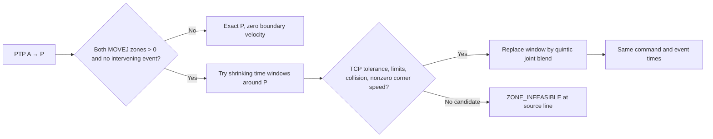

# First browser ZONE blend for consecutive PTP commands

Date: 2026-11-13. Scope: the browser workcell in `modelrobot_internal`. This is an amendment to [D-05](2026-11-13_workcell_roadmap.md), whose default exact stop remains in force. It is **our own** bounded blend rule. EASY-ROB's [ZONE investigation](../../notes/2026-11-12_easy_rob_orientation_zone.md) establishes that positive ZONE permits a flyby and that its API value is in millimetres; it does not establish a numeric radius law or exact blend curve. No equivalence to that binary is claimed.

## Physical and command contract

The world frame is Z-up, TCP positions are in metres, and joint values retain their URDF units (radians for revolute, metres for prismatic). `ZONE r` accepts a finite radius $0\le r\le0.2$ **metres** and remains active until changed. `ZONE 0` is the default. Each MOVEJ records the active value. Two consecutive MOVEJ commands may blend only if both recorded values are positive; the smaller value is used. `ZONE 0` on either move, a PAUSE (including `PAUSE 0`), GRAB, RELEASE, WELD command, or a LIN/CIRC boundary preserves the exact target stop. A positive ZONE with no compatible next MOVEJ also stops at its target.

At a compatible boundary, let $P$ be the programmed TCP waypoint, $p_0(t)$ the original stop-at-waypoint TCP path, and $p_b(t)$ the proposed blend. The planner checks at its generated samples that

$$\|p_b(t)-P\|\le r,\qquad \|p_b(t)-p_0(t)\|\le r,$$

and that orientation differs from the original by at most $0.05$ rad. The two spatial constraints give the student both a waypoint neighborhood and a maximum observed departure from the original timed path. They are sampled checks, not a continuous bound between samples. The planner also verifies sampled joint position, velocity and acceleration limits, collision states, and adaptively sampled edges. It rejects a requested compatible blend with a source-line `ZONE_INFEASIBLE` diagnostic if no tested candidate works; it does not silently insert a stop.

## Planned trajectory and playback

Each MOVEJ is first planned with its usual endpoint stop. Only moves that static command lookahead identifies as members of a compatible pair are time-scaled by $1.45$: their positions stay the same, velocities divide by $1.45$, accelerations by $1.45^2$, and durations increase by $45\%$. This reserves acceleration headroom for a useful flyby. **ZONE can increase cycle time**; it is not an optimization claim. For a compatible pair, the planner cuts a short window on both sides of the boundary. For each joint it fits two quintic polynomials in normalized time, matching $q$, $\dot q$ and $\ddot q$ at both cut points and at a shared non-stopping middle state. The middle position is biased toward the incoming direction for joints that are slowing and toward the outgoing direction for joints that are starting. Thus the **planned spline** is C2 at both cuts and the middle. Candidate windows shrink until the sampled checks pass, including a no-joint-reversal check in the corner window. The corner sample must have a nonzero dimensionless speed fraction, $\max_j |\dot q_j|/\dot q_{j,\max}>10^{-5}$; this avoids mixing radians/s with metres/s. The splice itself does not shift times established by the time-scaled moves or any later scene event. The Worker performs the blend immediately after planning the second MOVEJ, before any later GRAB/RELEASE/JOIN can alter the collision scene.

The exported `JointTrajectory`-shaped JSON has strictly increasing nanosecond timestamps. **2026-11-13 amendment:** `ProgramPlayer` now replays a quintic through each pair of sampled positions, velocities, and accelerations, giving C2 motion at those knots; see `notes/2026-11-13_smooth_playback.md`. The collision layer still checks sampled/adaptive configurations rather than proving continuous clearance.

## Evidence

- `tests/planning-zone.test.cjs` checks a non-stopping two-axis PTP corner, TCP/velocity/acceleration bounds, and rejection of a corner whose off-axis interior is blocked.
- `tests/program-zone.test.cjs` checks parser bounds, `ZONE 0`, `PAUSE 0`, Worker equivalence, strict ROS nanosecond ordering, joint-limit failure with the ZONE source line, and a later GRAB whose final attachment would incorrectly invalidate the earlier corner if collision checking were postponed.
- `node notes/scripts/check_zone_blend.cjs` loads the existing two-axis gantry and SDF scene in Chromium. At the exact boundary, `ZONE 0` yields $q=(0.4,0)$ with zero joint speed and total duration 2.65 s. `ZONE 0.07` yields $q\approx(0.396441,0.004470)$ and $\dot q\approx(0.018924,0.023902)$ m/s, a 0.005714 m TCP waypoint deviation, and total duration 3.84 s. The player's actual joint state matches that sample. Browser errors were empty; [screenshot](artifacts/zone_ptp_corner.png), [top-down trajectory comparison](artifacts/zone_ptp_topdown.png), and [JSON trace](artifacts/zone_ptp_browser.json) are archived. The top-down plot is generated from the Chromium planned-sample trace by `notes/scripts/plot_zone_blend.py`.

LIN/CIRC blends, orientation-specific zone tolerances, continuity across scene events, multi-robot synchronization, and exact continuous collision certificates are outside this first ZONE scope.
